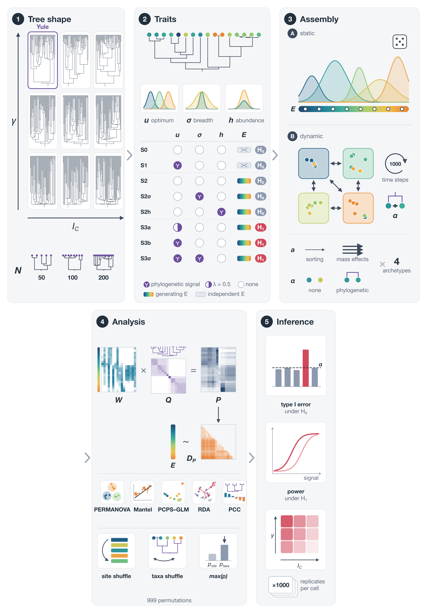

<!-- Render: quarto render docs/resumo_projeto.qmd (paths are relative to
docs/). Needs data/derived/{full,axes,layerB,clade}/results.csv and
data/derived/models/ (analysis/18 and 19), which are not in git
(download from S3, aws/README.md). No cache: the CSVs are read on every render
(~10 s). -->

```{r}
#| label: setup
library(dplyr)
library(tidyr)
library(ggplot2)
root <- ".."
# fread: the results files have 2-3.5 million rows
read_results <- function(profile, cols) {
  data.table::fread(file.path(root, "data", "derived", profile, "results.csv"),
                    select = cols) |>
    as_tibble()
}
reject_rate <- function(p) mean(p <= 0.05)
kable3 <- function(x, digits = 3) knitr::kable(x, digits = digits)
test_levels <- c("adonis", "mantel", "glm_pcps1", "glm_pcps2", "glm_pcps1_proc",
                 "glm_pcps2_proc", "rda_pcps", "pcc")
gamma_levels <- c("g_low", "g_mid", "g_yule")
colless_levels <- c("c_yule", "c_mid", "c_high")
type1_scenarios <- c("S0", "S1", "S2", "S2sigma", "S2h")
power_scenarios <- c("S3a", "S3b", "S3sigma")
# grid cells are named "g_<gamma level>__c_<Colless level>"
add_shape_levels <- function(d) {
  separate(d, cell, c("gamma", "colless"), sep = "__", remove = FALSE) |>
    mutate(gamma = factor(gamma, gamma_levels),
           colless = factor(colless, colless_levels))
}
# rejection rate of the max test, one column per test
rate_table <- function(d, scenarios, ...) {
  d |>
    filter(scenario %in% scenarios) |>
    mutate(scenario = factor(scenario, scenarios)) |>
    group_by(..., scenario, test) |>
    summarise(r = reject_rate(p_max), .groups = "drop") |>
    pivot_wider(names_from = test, values_from = r) |>
    kable3()
}
models_dir <- file.path(root, "data", "derived", "models")
model_names <- c("type_I", "power", "clade")
# posterior contrasts (median [95% CI]), one column per N
show_contrast <- function(d, ...) {
  d |>
    select(..., n_f, ci) |>
    pivot_wider(names_from = n_f, values_from = ci) |>
    select(..., any_of(c("50", "100", "200"))) |>
    kable3()
}
```

Este documento resume o estado do projeto em 19 de outubro de 2026. O registro
detalhado das decisões, com datas, commits e números, está em
`docs/MEMORIA_PROJETO.md`; o desenho, em `docs/PLANO_SIMULACAO.md`. As tabelas
são calculadas a partir dos resultados em `data/derived/` (fora do git; também
no S3). Todas as taxas são do teste max (largest P: o maior entre os p-valores
do site shuffle e do taxa shuffle), a α = 0,05. O critério de aceitabilidade do
erro tipo I é o intervalo liberal de Bradley, [0,025; 0,075]
[CITAR: Bradley 1978, não verificado]. O erro de Monte Carlo de uma taxa de 0,05
com 1000 réplicas é ±0,014.

# Pergunta e lacuna

O capítulo da tese (2012–2016) perguntava como o formato da árvore (γ de Pybus,
desbalanço de Colless) e o tamanho do pool afetam o autovalor do PCPS1. O
reenquadramento de 2026 troca a resposta (autovalor) pela **validade da
inferência**.

- **Objetivo 1:** erro tipo I e poder dos testes sobre a matriz P da
  *phylogenetic fuzzy weighting* (PFW) e sobre os eixos PCPS, em função de
  (a) formato da árvore, (b) sinal filogenético em σ e h sob H0, (c) tamanho
  do pool e (d) incidência × abundância.
- **Objetivo 2:** comparar métodos. Por ora, PFW/PCPS e o PCC de Peres-Neto &
  Kembel 2015; evoPCA e phylofactorization estão pendentes.

A lacuna se apoia em três pontos verificados:

- Duarte et al. 2016 (*MEE* 7: 937–946) afirmam que a PFW "incorporates ...
  phylogenetic unbalance", mas simulam só árvores Yule, sem controlar γ ou
  Colless (Appendix S2).
- Peres-Neto & Kembel 2015 (*Plant Ecol* 216: 709–724, p. 717) pedem
  explicitamente estudos do desempenho sob diferentes formatos de árvore.
- A busca ampla (349 trabalhos citantes de PCPS/PFW) não achou nenhum estudo
  que varie γ ou Colless ao avaliar esses métodos.

Revista-alvo: **Methods in Ecology and Evolution**. Autoria única.

# O que foi construído

- **Compêndio** `~/Github/pcps-sim` (público, MIT/CC BY 4.0), com `renv`,
  testes unitários (`tests/testthat`) e pipeline `targets` + `crew`, com um
  perfil por rodada e um store por perfil.
- **Implementações próprias**, conferidas contra os pacotes de referência:
  matriz P (= `SYNCSA::matrix.p`), ADONIS e Mantel (= `vegan`), GLM sobre eixos
  PCPS (= `PCPS::pcps.sig`), PCC reimplementado a partir do artigo e do
  Appendix A (não há código público), RDA e GLM com Procrustes nos eixos 1–2.
  Todos os testes usam sqrt(Bray–Curtis), que é euclidiana (BC puro deu
  autovalores negativos em 100% das matrizes testadas).
- **Gerador de árvores** com γ e Colless controlados de forma independente
  (topologia pelo *beta-splitting* de Aldous; tempos por um processo de
  nascimento puro com taxa k^c por linhagem), com rejeição por tolerância
  (±0,5) e uma grade 3 × 3 (γ: Yule / intermediário / baixo; Colless: Yule /
  intermediário / alto) × N = 50/100/200.
- **Referência empírica:** clados de 40–250 pontas da árvore datada de anuros
  de Portik et al. 2023 (*MPE*, GPL-3.0, SHA-256 conferido no OSF). Os alvos
  "baixo" de γ (q10 ≈ −5,6 a −8,9) e "alto" de Colless (q90) vêm daí.
- **Camada A:** metacomunidades estáticas no protocolo de Peres-Neto, Leibold &
  Dray 2012, com 8 cenários (abaixo).
- **Camada B:** dinâmica de metacomunidade baseada em processo, no modelo de
  Thompson et al. 2020 (*Ecol Lett* 23: 1314–1329): crescimento Gaussiano,
  Beverton–Holt, Poisson, emigração binomial e dispersão uniforme. Código
  próprio (nem o mcomsimr nem o código Julia têm licença). A ordem dentro do
  passo (Poisson → emigração → imigração) confere com as Eqs. 1, 2 e 4 do
  artigo.
- **AWS:** imagem Docker (rocker 4.6.1, OpenBLAS com 1 thread), instância spot
  c7a.48xlarge (190 workers), store sincronizado com o S3 a cada 10 min, com
  retomada automática.
- **Figura 1** (esquema do desenho), em `manuscript/figures/`.

{width=100%}

## Cenários

| Cenário | λ dos ótimos | Sinal em σ / h | Gradiente analisado | Estima |
|---|---|---|---|---|
| S0 | 0 | não | aleatório | tipo I |
| S1 | 1 | não | aleatório | tipo I |
| S2 | 0 | não | o verdadeiro | tipo I (componente filogenético) |
| S2sigma | 0 | σ | o verdadeiro | tipo I (componente filogenético) |
| S2h | 0 | h | o verdadeiro | tipo I (componente filogenético) |
| S3a | 0,5 | não | o verdadeiro | poder |
| S3b | 1 | não | o verdadeiro | poder |
| S3sigma | 1 | σ | o verdadeiro | poder |

# Validação e pilotos

Com 1000 réplicas por célula e critério "a taxa publicada cai no IC95% da
nossa":

- **Duarte et al. 2016:** 68 de 72 células dentro do IC (~3 fora seriam
  esperadas por acaso); médias de ρ e R² iguais até a 2ª casa. O ADONIS
  publicado usa Bray–Curtis **sem** raiz, apesar do texto dos Métodos
  (confirmado no código do Appendix S3).
- **Peres-Neto & Kembel 2015 (PCC):** validado nas células que não dependem da
  árvore. O poder publicado fica no extremo superior do que obtemos em 20
  árvores Yule (0,71–0,925), compatível com uma árvore única favorável. Nessas
  20 árvores, o poder do PCC já correlacionava com γ (Spearman 0,87–0,90).

Pilotos que orientaram o desenho (detalhes na memória):

- **Piloto do formato da árvore** (3 células, 200 réplicas): o γ baixo derrubou
  o poder do PCC (N = 50: 0,33 contra 0,87 em Yule), e a PFW passou à frente
  (Mantel 0,49). Foi a primeira evidência para a H4.
- **Mini-piloto GLM** (14.400 réplicas, AWS): revelou a inflação do GLM no
  PCPS2 em S2sigma (0,10). O diagnóstico (`analysis/09`) atribuiu o problema à
  identidade dos eixos no teste eixo a eixo; daí a inclusão de Procrustes e RDA.
- **Calibração e piloto da camada B** (8.800 réplicas): definiram os tamanhos de
  pool, mostraram a célula inviável e o confundimento entre a poda competitiva
  e o γ, o que levou à opção B (seção 5).

# Camada A: resultados

Duas rodadas completas na AWS, cada uma com 432.000 réplicas (8 cenários × 9
células × 3 N × incidência/abundância × 1000): **full** (ADONIS, Mantel, GLM
PCPS1/2, PCC) e **axes** (os mesmos sem PCC, mais GLM com Procrustes, RDA nos
eixos 1–2 e a fração da variação em cada eixo).

```{r}
#| label: layerA-data
cols <- c("scenario", "cell", "n_spp", "data_type", "test", "p_max")
full <- read_results("full", cols)
axes <- read_results("axes", c(cols, "eig_share1", "eig_share2"))
layerA <- bind_rows(full, filter(axes, !test %in% unique(full$test))) |>
  mutate(test = factor(test, test_levels))
```

## Erro tipo I

```{r}
#| label: layerA-type1
rate_table(layerA, type1_scenarios)
```

- S2 e S2h: dentro do intervalo de Bradley em todos os testes, exceto os GLM
  com Procrustes, conservadores demais. S0 e S1: conservadores em todos os
  testes (≤ 0,033).
- **S2sigma** (sinal filogenético só na amplitude de nicho): o GLM no PCPS2
  (0,12) e o PCC (0,08) passam do limite. A inflação do GLM PCPS2 cresce com N
  e com γ baixo (tabela abaixo). Diagnóstico (`analysis/09`): o clado de nicho
  amplo gira os eixos principais, e o PCPS2 nulo do taxa shuffle não é o mesmo
  eixo que o PCPS2 observado.
- O PCC também infla em S2sigma, mais com N grande e em árvores Yule (0,13 com
  N = 200), o oposto do GLM PCPS2.
- O Procrustes remove a inflação, mas fica conservador demais em toda parte. A
  RDA nos eixos 1–2 controla o erro tipo I (e fica conservadora com N grande).
- O Colless não muda o erro tipo I em nenhum teste (diferenças ≤ 0,007 entre
  os níveis).

```{r}
#| label: layerA-s2sigma
layerA |>
  filter(scenario == "S2sigma", test %in% c("glm_pcps2", "pcc", "rda_pcps")) |>
  add_shape_levels() |>
  group_by(test, gamma, n_spp) |>
  summarise(r = reject_rate(p_max), .groups = "drop") |>
  pivot_wider(names_from = n_spp, values_from = r, names_prefix = "N = ") |>
  kable3()
```

## Poder

```{r}
#| label: layerA-power
rate_table(layerA, power_scenarios)
```

```{r}
#| label: fig-layerA-power-cell
#| fig-cap: "Poder em S3b por célula de forma da árvore (incidência e abundância juntas). Linhas: N."
#| fig-width: 9
#| fig-height: 5
layerA |>
  filter(scenario == "S3b", !test %in% c("glm_pcps2", "glm_pcps2_proc")) |>
  add_shape_levels() |>
  group_by(test, gamma, colless, n_spp) |>
  summarise(r = reject_rate(p_max), .groups = "drop") |>
  ggplot(aes(gamma, r, colour = factor(n_spp), group = n_spp)) +
  geom_line() + geom_point() +
  facet_grid(colless ~ test) +
  labs(x = "γ", y = "Taxa de rejeição", colour = "N") +
  theme_bw(base_size = 10)
```

- O ADONIS é o mais poderoso entre os testes sobre D_P e quase insensível à
  forma da árvore.
- γ baixo (o realista para anuros) derruba o poder do GLM PCPS1, da RDA e do
  PCC. Isso muda a ordem dos métodos. Em árvores Yule, o PCC é o mais poderoso
  em S3b e S3sigma (S3b, N = 50: 0,84 contra 0,59 do ADONIS). Com γ baixo, o
  ADONIS empata ou supera o PCC (S3b, N = 50: 0,49 contra 0,39). Em S3a (sinal
  fraco, λ = 0,5), o ADONIS supera o PCC em quase todas as células (γ baixo,
  N = 200: 0,68 contra 0,42).
- O Colless não tem efeito visível.

## Incidência × abundância

```{r}
#| label: layerA-datatype
layerA |>
  filter(scenario %in% c("S2sigma", power_scenarios),
         test %in% c("adonis", "mantel", "glm_pcps1", "glm_pcps2", "pcc")) |>
  group_by(scenario, test, data_type) |>
  summarise(r = reject_rate(p_max), .groups = "drop") |>
  pivot_wider(names_from = data_type, values_from = r) |>
  kable3()
```

A incidência dá mais poder que a abundância no ADONIS, no Mantel e sobretudo
no GLM PCPS1 (S3b: 0,55 contra 0,21). No PCC, os dois tipos de dado se
equivalem. Em contrapartida, a inflação em S2sigma é maior com incidência (GLM
PCPS2 0,15 contra 0,09; PCC 0,11 contra 0,05).

## Espectro: fração da variação no PCPS1

```{r}
#| label: layerA-eig
axes |>
  filter(test == "adonis", scenario %in% c("S0", "S3b")) |>
  add_shape_levels() |>
  group_by(scenario, gamma) |>
  summarise(eig_share1 = mean(eig_share1), eig_share2 = mean(eig_share2),
            .groups = "drop") |>
  kable3()
```

A fração da variação no PCPS1 diminui com γ baixo, o que reproduz na grade
completa o resultado do rascunho de 2012 (só γ afetava o PCPS1) e explica a
perda de poder dos testes sobre o PCPS1.

# Camada B: resultados

**Desenho.** 5 células da grade (as 4 quinas e o centro) × 4 arquétipos
(*species sorting*, dispersão 0,01, ou *mass effects*, dispersão 0,5 × sem
competição ou com competição filogenética) × 8 cenários × N = 50/100/200, com
incidência e 1000 réplicas: 440.000 réplicas, completas. Duas decisões tomadas
no caminho:

- **Tamanho do pool calibrado** para que a riqueza depois da exclusão
  competitiva fique perto de N. A célula *mass effects* com competição
  filogenética e N = 200 é **inviável**: pools de até 2.900 pontas dão só ~150
  espécies (um teto de coexistência regional). Ela foi retirada.
- **Opção B para o γ:** a célula da grade define a árvore do *pool* regional
  (com β e c recalibrados para cada tamanho de pool), e não a da metacomunidade
  analisada. O γ e o Colless da árvore podada entram como covariáveis.

```{r}
#| label: layerB-data
layerB <- read_results("layerB", c("scenario", "archetype", "cell", "n_spp", "test",
                                   "p_max", "n_realized", "gamma_pool",
                                   "colless_pool", "gamma", "colless")) |>
  filter(test %in% c("adonis", "mantel", "glm_pcps1", "glm_pcps2", "rda_pcps", "pcc")) |>
  mutate(test = factor(test, test_levels))
```

## A árvore do pool e a árvore analisada

```{r}
#| label: layerB-shapes
layerB |>
  filter(test == "adonis") |>
  mutate(gamma_cell = factor(sub("__.*", "", cell), gamma_levels)) |>
  group_by(archetype, gamma_cell) |>
  summarise(gamma_pool = mean(gamma_pool), gamma_analysed = mean(gamma),
            colless_pool = mean(colless_pool), colless_analysed = mean(colless),
            n_realized_over_N = mean(n_realized / n_spp), .groups = "drop") |>
  kable3(2)
```

A árvore do pool cai nos alvos da célula em todos os arquétipos, o que mostra
que a opção B funciona (o γ médio menos negativo de *mass effects* com
competição vem da falta do N = 200, cujos alvos são os mais negativos). Sem
competição, a árvore analisada é praticamente a do pool. A competição
filogenética poda parentes próximos. O γ fica mais negativo (pool Yule → −1,9
a −2,4). O Colless cai cerca de 45% com *species sorting* e cerca de 75% com
*mass effects*: a árvore analisada fica *mais* balanceada que o pool.

## Erro tipo I

```{r}
#| label: layerB-type1
rate_table(layerB, type1_scenarios, archetype)
```

- Todos os testes ficam dentro do intervalo de Bradley ou abaixo, com duas
  exceções na borda: o **PCC em S2h** (sinal em h, a taxa máxima de
  crescimento) sem competição (0,076–0,078), e o **GLM PCPS2 em S2sigma** com
  *species sorting* sem competição (0,073; 0,096 com N = 200). Esse último
  repete, mais fraco, a inflação da camada A.
- Com *species sorting* e competição filogenética, ADONIS e RDA ficam muito
  conservadores em S2, S2h e S2sigma (0,013–0,023).
- A inflação do ADONIS em S2sigma com *mass effects* vista no piloto (0,09 com
  100 réplicas) não se confirma (0,057; 0,065 com N = 200).

## Poder

```{r}
#| label: layerB-power
rate_table(layerB, power_scenarios, archetype)
```

```{r}
#| label: layerB-power-gamma
layerB |>
  filter(scenario == "S3b", test != "glm_pcps2") |>
  mutate(gamma_cell = factor(sub("__.*", "", cell), gamma_levels)) |>
  group_by(archetype, test, gamma_cell) |>
  summarise(r = reject_rate(p_max), .groups = "drop") |>
  pivot_wider(names_from = gamma_cell, values_from = r) |>
  kable3()
```

- Com *species sorting*, o poder é parecido com o da camada A (ADONIS e Mantel
  0,74–0,84 em S3b, PCC 0,82–0,84).
- Com *mass effects*, a dispersão alta homogeneiza os sítios e o poder cai
  muito (ADONIS 0,19–0,27 em S3b). **O PCC perde todo o poder** (0,02–0,04,
  abaixo do nominal), enquanto os testes sobre D_P mantêm algum.
- **O efeito do γ da camada A se repete no modelo de processo:** com o pool de
  γ baixo, o GLM PCPS1 cai de 0,76 para 0,34 (*sorting* sem competição), o PCC
  de 0,95 para 0,69 e a RDA de 0,79 para 0,63; o ADONIS quase não muda
  (0,80–0,82). Com *mass effects*, o γ baixo reduz todos os testes sobre D_P.
- O GLM PCPS2 segue sem poder (≤ 0,03 com *sorting*).
- Uma tabulação pelo γ *realizado* fica confundida com N (os alvos de γ baixo
  são mais negativos com N grande); por isso o GAM abaixo é ajustado dentro de
  cada N.

## GAM pelo γ da árvore analisada

GAM binomial (`mgcv::gam`, REML) da rejeição sobre s(γ) + s(Colless) da
árvore analisada, **um modelo por teste × cenário × arquétipo × N** (704
modelos de 5000 réplicas; `analysis/14_gam_layerB.R`). Ajustar por estrato
evita misturar *sorting* com *mass effects* e extrapolar γ entre N (o γ
realizado fica mais negativo com N maior). Curvas condicionais à mediana do
Colless, com IC de 95%, entre os quantis 2,5% e 97,5% do γ de cada estrato.

O γ realizado se agrupa em torno das células do pool: dentro de um estrato, a
correlação com o γ do pool vai de 0,83 a 0,9997 (> 0,99 sem competição). Por
isso as curvas omitem os trechos sem dados (a mais de 0,25 de qualquer γ
observado), e o contraste entre os extremos das curvas repete, em essência, o
contraste entre células da tabela anterior. Cada réplica sorteia sua própria
árvore do pool dentro da tolerância da célula, então nem a célula fixa o pool.
Para separar a árvore analisada do pool, uma regressão logística por estrato
usa a célula, o γ da árvore do pool, a **mudança de γ causada pela poda**
(γ − γ do pool) e o Colless; a inclinação da mudança é o efeito da árvore
analisada além do seu pool.

```{r}
#| label: layerB-gam
gam_dir <- file.path(root, "data", "derived", "layerB_gam")
gam_curves <- readr::read_csv(file.path(gam_dir, "gam_gamma_curves.csv"),
                              show_col_types = FALSE)
gam_curves |>
  filter(scenario == "S3b", n_spp == 100, test %in% test_levels, !is.na(rate)) |>
  mutate(test = factor(test, test_levels)) |>
  group_by(archetype, test) |>
  summarise(gamma_low = first(gamma), rate_low = first(rate),
            gamma_high = last(gamma), rate_high = last(rate), .groups = "drop") |>
  kable3(2)
```

```{r}
#| label: fig-layerB-gam
#| fig-cap: "Taxa de rejeição (N = 100) ao longo do γ da árvore analisada, por arquétipo (linhas) e cenário (colunas); faixas = IC 95%; tracejado = 0,05; lacunas = γ sem dados."
knitr::include_graphics(file.path(gam_dir, "gam_gamma_curves_n100.png"))
```

```{r}
#| label: layerB-pruning
# slope of the pruning shift (gamma - gamma_pool), logit per unit of gamma
readr::read_csv(file.path(gam_dir, "pruning_gamma_slopes.csv"),
                show_col_types = FALSE) |>
  filter(scenario == "S3b", !grepl("pcps2|proc", test)) |>
  mutate(slope = sprintf("%.2f [%.2f, %.2f]", slope, lower, upper)) |>
  select(archetype, test, n_spp, shift_sd, slope) |>
  pivot_wider(names_from = n_spp, values_from = c(shift_sd, slope)) |>
  kable3(2)
```

- **Entre células**, o padrão da tabela anterior se mantém pelo γ da árvore
  analisada. Em S3b com *sorting* sem competição e N = 100: GLM PCPS1
  0,39 → 0,84, PCC 0,70 → 0,99, RDA 0,67 → 0,84; ADONIS (0,85) e Mantel
  (0,84–0,91) quase planos. Com N = 200, o ADONIS e o Mantel até caem um
  pouco com γ alto (0,97 → 0,90; 0,98 → 0,95), e o PCC quase não perde
  (0,93 → 1,00).
- **Efeito da poda.** Só com *sorting* e competição filogenética a mudança
  de γ causada pela poda tem efeito próprio e consistente: 35 de 72 estratos
  de poder com IC acima de zero e nenhum abaixo. Uma árvore analisada com γ
  mais negativo que o seu pool perde poder. Os maiores efeitos são do PCC
  (até 0,46 no logit por unidade de γ) e do Mantel (até 0,29); ADONIS, GLM
  PCPS1 e RDA ficam em 0,10–0,22. O efeito enfraquece com N = 200 (4 de 24
  estratos, contra 15–16 com N = 50 e 100). Sem competição a poda quase não muda o γ (DP da mudança 0,1–0,3).
  Com *mass effects* e competição a mudança é grande (DP ~1,2), mas só 2 de 48
  estratos de poder mostram efeito.
- Nos cenários de erro tipo I, 27 de 440 estratos têm IC da inclinação que
  exclui zero, nos dois sentidos (~22 esperados ao acaso).
- **Erro tipo I nas curvas.** Em 41 estratos o IC inferior passa de 0,05 em
  algum ponto; em 6 passa de 0,075 (limite superior de Bradley): GLM PCPS2 em
  S2sigma com *sorting* e N = 200, que sobe com γ muito negativo (até 0,13), e
  PCC em S2h com N = 100–200 (até 0,135).
- O termo do Colless tem p < 0,01 em 67 de 704 modelos, sempre com efeito
  pequeno.
- **Limites:** em S0 e S1 a rejeição também cai com γ baixo (testes mais
  conservadores), então parte da perda de poder pode ser calibração. O GAM é
  aditivo em γ e Colless (sem `te()`), os IC são pontuais e há 704 modelos
  sem correção para multiplicidade. Exploratório; o final será em `brms`.

# Objetivo 2: recuperação de um clado plantado

**Desenho.** Em cada réplica sorteia-se um nó cujo clado tem 10–30% das
espécies, na metade mais antiga ("old") ou mais recente ("young") dos nós
possíveis. Os ótimos das espécies desse clado são deslocados ao longo de E
(u = −1 + 102·Φ(z + shift), z iid N(0, 1)); as demais espécies não têm sinal.
Cada método dá um escore por nó: PCPS, evoPCA e PCC pela |correlação| entre
pertencer ao clado e o escore das espécies no eixo (entre os 4 primeiros) mais
correlacionado com E; o phylofactor (binomial com incidência, composicional
com abundância) pelo seu próprio critério em cada partição. **Acerto** = o
clado de maior escore é o plantado. Grade 3 × 3 × N 50/100/200 × 2
profundidades × deslocamentos 0,5/1/2 × 1000 réplicas com incidência, mais
abundância com N = 100: 864 mil linhas, sem NA. Rodou localmente (16 núcleos,
1h11). Desenho pareado: para uma réplica, o clado plantado, os ótimos e o
gradiente são os mesmos entre deslocamentos e tipos de dado.

```{r}
#| label: clade-data
clade <- read_results("clade", c("cell", "n_spp", "data_type", "depth", "shift",
                                 "method", "hit")) |>
  add_shape_levels()
clade |>
  filter(data_type == "incidence", shift == 2) |>
  group_by(n_spp, depth, method) |>
  summarise(hit = mean(hit), .groups = "drop") |>
  pivot_wider(names_from = method, values_from = hit) |>
  kable3(2)
```

```{r}
#| label: clade-shape
clade |>
  filter(data_type == "incidence", shift == 2, n_spp == 100) |>
  group_by(gamma, depth, method) |>
  summarise(hit = mean(hit), .groups = "drop") |>
  pivot_wider(names_from = method, values_from = hit) |>
  arrange(depth, gamma) |>
  kable3(2)
```

- **evoPCA e phylofactor** recuperam o clado na maioria das réplicas com
  deslocamento 2 (0,44–0,88, conforme N e profundidade) e quase não dependem da
  forma da árvore.
- **PCPS** acerta bem menos (0,12–0,42) e depende muito do γ: com N = 100,
  clados antigos 0,55 com γ baixo contra 0,19 em árvores Yule; recentes 0,28
  contra 0,03. Interpretação minha, não verificada nos dados: a ponderação
  filogenética de P espalha o sinal pelos parentes do clado, e o PCPS tende a
  escolher um clado maior.
- **PCC**, com os 4 primeiros autovetores, quase não isola clados desse
  tamanho (0,08–0,12); suponho que porque esses autovetores seguem as divisões
  profundas.
- Com deslocamento 0,5 todos os métodos ficam em 0,04–0,21.

# Modelos formais

**Modelo.** Beta-binomial (`brms`, 4 cadeias × 2000 iterações) das taxas
agregadas por condição (1000 réplicas cada), separadamente para erro tipo I e
poder da camada A e para a recuperação de clados. γ e Colless entram como
fatores de 3 níveis com a interação γ × Colless (a superfície do plano):
cada célula tem um único alvo por eixo e a camada A não guardou o γ de cada
árvore, então um termo contínuo só interpolaria 3 pontos (decisão aceita pelo
Diogo). Os efeitos de forma interagem com o teste (ou método), o cenário
(camada A), a profundidade (clados), N e o tipo de dado. Priors: normal(0; 1,5)
nos coeficientes (escala logit); intercepto normal(−2,9; 1,5) no erro tipo I e
normal(0; 1,5) nos demais; φ ~ gamma(2; 0,01). A primeira versão, com efeito
aleatório por condição, batia no treedepth máximo em 99% das transições; a
beta-binomial resolveu. Código em `analysis/18_formal_models.R` e
`analysis/19_shape_contrasts.R`; saídas em `data/derived/models/`.

```{r}
#| label: model-diagnostics
purrr::map(model_names, \(m) {
  readr::read_csv(file.path(models_dir, m, "diagnostics.csv"), show_col_types = FALSE) |>
    mutate(model = m, .before = 1)
}) |>
  bind_rows() |>
  kable3(3)
```

Os três modelos convergiram (R-hat ≤ 1,005, ESS bulk ≥ 914, nenhuma divergência,
nenhuma transição no treedepth máximo). O teste preditivo é in-sample: 97–98%
das condições caem no intervalo de 95%, e agrupando por teste × N × célula
todos os grupos caem nele. As previsões são conservadoras, e esse teste agrupado
quase não discrimina. No poder, a sobredispersão quasibinomial segue alta (13),
o que indica estrutura ainda não modelada (talvez cenário × N).

```{r}
#| label: contrasts
contrasts <- readr::read_csv(file.path(models_dir, "contrasts.csv"), show_col_types = FALSE) |>
  mutate(ci = sprintf("%+.3f [%+.3f, %+.3f]", median, lower, upper))
```

**Contrastes** (mediana [IC 95%] da diferença de taxa; γ baixo − Yule no
Colless Yule; colunas = N).

*Erro tipo I, efeito do sinal em σ e h* (S2sigma ou S2h − S2, mesmo gradiente
sem sinal), incidência:

```{r}
#| label: contrasts-h2
contrasts |>
  filter(model == "type_I", grepl("^S2", contrast), data_type == "incidence") |>
  show_contrast(contrast, test)
```

*Poder, γ baixo − Yule*, incidência:

```{r}
#| label: contrasts-power
contrasts |>
  filter(model == "power", contrast == "gamma low - yule", data_type == "incidence") |>
  show_contrast(test, scenario)
```

*Recuperação de clados, γ baixo − Yule*, incidência:

```{r}
#| label: contrasts-clade
contrasts |>
  filter(model == "clade", contrast == "gamma low - yule", data_type == "incidence") |>
  show_contrast(method, depth)
```

*Abundância*, γ baixo − Yule (camada A com N = 50/100/200; nos clados só
existe N = 100):

```{r}
#| label: contrasts-abundance
contrasts |>
  filter(contrast == "gamma low - yule", data_type == "abundance") |>
  mutate(group = coalesce(test, method), level = coalesce(scenario, depth)) |>
  show_contrast(model, group, level)
```

```{r}
#| label: fig-surface-power
#| fig-cap: "Poder estimado (N = 100, incidência) sobre a grade γ × Colless, por teste e cenário."
knitr::include_graphics(file.path(models_dir, "power", "shape_surface.png"))
```

```{r}
#| label: fig-surface-clade
#| fig-cap: "Acerto estimado do clado plantado (N = 100, incidência, deslocamento 2) sobre a grade γ × Colless, por método e profundidade."
knitr::include_graphics(file.path(models_dir, "clade", "shape_surface.png"))
```

- **Colless** quase não importa em nada: no erro tipo I, |taxa − 0,05| com
  Colless alto − Yule fica em ±0,011 e nenhum dos 75 contrastes (teste ×
  cenário × N) exclui zero, com incidência ou abundância. No poder e nos
  clados, Colless alto muda as taxas de −0,10 a 0 (−0,01 a −0,08 com N = 100).
- **Sinal em σ** (S2sigma) infla o erro tipo I só no GLM PCPS2 (+0,03 em
  Yule; +0,09/+0,11/+0,16 com γ baixo e N = 50/100/200) e no PCC (+0,045 em
  Yule; +0,02 com γ baixo, ICs que se sobrepõem). ADONIS, GLM PCPS1 e Mantel ficam mais
  conservadores (−0,01 a −0,03). Com abundância, o mesmo padrão, mais fraco no
  GLM PCPS2 (+0,09 com γ baixo e N = 100). **Sinal em h** não tem efeito.
- **Poder:** com γ baixo o GLM PCPS1 perde 0,32–0,46 (pior com N maior); o PCC
  perde 0,07–0,48 (em S3b e S3sigma a perda diminui com N; em S3a aumenta); o
  Mantel perde até 0,23; o ADONIS vai de −0,17 a +0,08 (perde com N = 50 e em
  S3a, ganha com N = 200). A ordem dos métodos muda (N = 100): em S3a o GLM
  PCPS1 cai de 2º para 4º; em S3b o PCC cai de 1º para 3º.
- **Clados:** com γ baixo o PCPS ganha +0,23 a +0,45 (mais com N maior, mais
  nos antigos); evoPCA e phylofactor não mudam; o PCC perde nos antigos
  (−0,10 a −0,14) e ganha nos recentes (+0,07 a +0,09).
- O modelo não tem cenário × N, então a variação com N do efeito de σ vem só
  da escala logit.

# Hipóteses

Leitura a partir dos modelos formais (seção anterior) e das tabelas descritivas:

- **H1** (o desbalanço afasta do nominal o erro tipo I do taxa shuffle sobre
  D_P): **sem evidência.** Nenhum contraste de Colless alto contra Yule
  exclui zero (|Δ| ≤ 0,011). Não testei o nível médio de Colless nem a parte
  comparativa da H1 (taxa shuffle contra métodos só de distância); a resposta
  modelada é o teste max, não o taxa shuffle isolado.
- **H2** (sinal filogenético em σ ou h infla o erro tipo I em todos os
  métodos, com magnitude dependente da forma): **rejeitada como enunciada.**
  Só o sinal em σ infla, e só no GLM PCPS2 e no PCC; os outros três testes
  ficam mais conservadores. No GLM PCPS2 a inflação cresce muito com γ baixo;
  no PCC ela parece diminuir, mas os ICs se sobrepõem. O sinal em h não muda
  nada na camada A; na camada B, o PCC em S2h fica na borda (0,076–0,078).
  Ressalvas: contraste só no Colless Yule, e a resposta é o teste max, não o
  componente filogenético isolado.
- **H3** (γ muito negativo concentra a variação no PCPS1 e favorece a
  recuperação de clados basais, não a dos recentes): **parcial.** A fração no
  PCPS1 *diminui* com γ baixo (contraria a primeira parte; leitura das tabelas
  descritivas, sem modelo formal). Na recuperação, o
  PCPS melhora muito com γ baixo, nos clados antigos e também nos recentes; a
  vantagem dos antigos é só de grau. Não há nível com γ acima de Yule.
- **H4** (a ordem dos métodos muda com a forma da árvore): **sustentada para o
  poder** (modelo formal da camada A, S3a e S3b com N = 100; na camada B, só
  descritivo). Na recuperação de clados, evoPCA e phylofactor ficam sempre no
  topo; PCPS e PCC trocam de lugar só nos clados recentes (em Yule, PCC 0,045
  contra PCPS 0,028 com N = 100).

# Infraestrutura e custo

| Rodada | Réplicas | Duração |
|---|---|---|
| Bench | — | < 1 h |
| Mini-piloto GLM | 14.400 | ~21 min |
| full | 432.000 | ~8 h |
| axes | 432.000 | ~6,6 h |
| layerB (+ reexecução) | 440.000 | 6,6 h + 0,9 h |
| clade (local, 16 núcleos) | 216.000 metacomunidades (× 4 métodos) | 1,2 h |
| Modelos `brms` (local) | — | ~5 min |

Pelo preço spot registrado (US$ 2,6–3,3/h), as quatro rodadas grandes custam
algo como US$ 60–75 no total. É estimativa minha (horas × preço), não a
fatura. Lições operacionais (na memória): o token SSO expira em ~8 h (`aws sso
login --profile pcps`); a instância encerrada some do `describe-instances`; o
furrr precisa de `scheduling = Inf` para balancear a carga; o OpenBLAS precisa
de 1 thread por worker (ganho de 2–3× nos testes). O store `_targets_layerB`
ficou com branches de duas versões de `run_chunk_B()`: um `tar_make` novo nele
refaria quase tudo (o `results.csv` já é o final).

# Próximos passos

**Imediatos**

1. Camada B: decidir se entra um modelo formal (`brms`) também para ela ou
   só os resultados descritivos e o GAM; entender por que o PCC perde o poder
   sob *mass effects*.
2. Modelos formais: limitações registradas (sem cenário × N; só Colless alto
   contra Yule na H1; teste preditivo in-sample).
3. Pools regionais empíricos (opção b) e incerteza dos quantis com os
   bootstraps de Portik: ainda não feitos.

**Decididos (Diogo, 2026-10-19)**

4. Bootstraps datados de Portik et al. 2023: baixados (100 árvores); falta
   usá-los para a incerteza dos quantis empíricos de γ e Colless.
5. Objetivo 2: evoPCA (Pavoine 2016; `adiv`) e phylofactorization (Washburne
   et al. 2017) entram; recuperação de clados por **clado plantado** (feito,
   seção 6).
6. Sem segundo simulador: o modelo de Thompson et al. 2020 basta.
7. Pools regionais empíricos (opção b): juntar as listas de espécies das
   metacomunidades de girinos do projeto NRI vs PCPS por região, atualizar os
   nomes para a taxonomia de Portik e podar a árvore de Portik (pools de
   50–200 spp.).
8. Figura 1: painel 5 ilustrativo; rótulos e triplot da RDA ajustados.

**Manuscrito**

9. Conferir as normas de autores e de figuras da MEE.
10. Escrever Métodos e Resultados (em inglês) a partir das tabelas finais; a
    Introdução usa a lacuna da seção 1.
11. Agradecimentos: V. J. Debastiani, L. D. S. Duarte, A. S. Melo
    (orientador) e a banca (M. V. Cianciaruso, T. Rangel, T. Quental); a ideia
    da simulação é do Diogo. Declarar a tese de 2015, se o capítulo estiver
    nela.
12. Leituras pendentes: texto completo de Pavoine 2016, Tucker et al. 2017 e
    Peres-Neto et al. 2012 (variação do formato da árvore); ter Braak et al.
    2017 e Duarte et al. 2018 (crítica à CWM sobre P); Bradley 1978 (critério
    de erro tipo I). Confirmar o DOI canônico do pacote PCPS (Debastiani &
    Duarte 2014).
