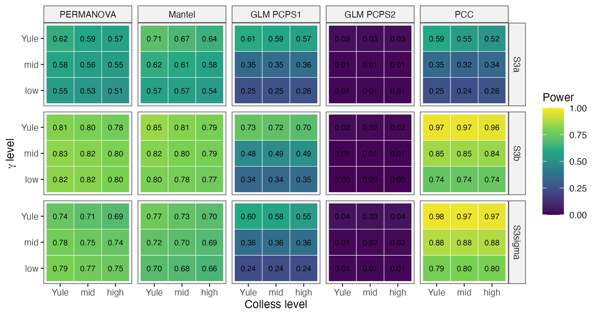

<!-- Draft of Methods and Results. Render: quarto render manuscript/methods_results.qmd
(figures in manuscript/figures/, made by analysis/13_fig1_schematic.R and
analysis/22_manuscript_figures.R; Supporting Information in
manuscript/supporting_information.qmd). Unverified references are marked
[CITAR: ...]. Numbers come from data/derived/ (see docs/MEMORIA_PROJETO.md). -->

# Abstract

1. Tests relating the phylogenetic structure of metacommunities to environmental gradients, such as the principal coordinates of phylogenetic structure (PCPS) and the phylogenetic community composition approach (PCC), were validated with static simulations, on trees close to Yule and with niche breadth independent of the phylogeny. However, real phylogenies vary in imbalance and branching times, and dispersal and competition assemble metacommunities, so their published performance may not hold for empirical data.

2. We simulated metacommunities on a grid of tree shapes that crossed the distribution of branching times (γ) with topological imbalance (Colless index), with levels from anuran clades, in a static layer reproducing the original validations and a process-based layer with species sorting, mass effects and phylogenetic competition. We modelled the type I error and power of six tests, and clade recovery by four ordination and factorization methods, with beta-binomial models.

3. Tree imbalance did not affect the type I error of any test. Phylogenetic signal in niche breadth inflated the type I error of the linear model on the second PCPS axis, up to 0.36 with low γ and 200 species, and of the PCC, up to 0.22. With 100 species, low γ reduced the power of the linear model on the first PCPS axis by 0.40 and that of the PCC by 0.25, whereas PERMANOVA was less sensitive to tree shape. Mass effects reduced the power of every test except the second PCPS axis, by 0.55–0.93 in Yule trees, and almost abolished that of the PCC. With the largest shift, evoPCA and phylofactorization recovered a planted clade in 0.44–0.88 of the replicates on average, regardless of γ, whereas PCPS depended strongly on γ and PCC rarely found the clade.

4. Performance seems to depend on branching times and on the assembly process rather than on tree imbalance. Three regional anuran pools fell at moderate levels of the simulated grid. We recommend reporting γ of the analysed tree, not relying on a single test, interpreting the second PCPS axis and the PCC with caution when niche breadth may be phylogenetically conserved, and using evoPCA or phylofactorization to identify the clades associated with a gradient.

Data and code availability for review: the code, the rates aggregated by condition and the scripts that reproduce every table and figure are available in an anonymized archive for review (https://doi.org/10.5281/zenodo.23500661); the public repository and its Zenodo archive will be cited after review.

Keywords: γ statistic, metacommunity phylogenetics, phylogenetic fuzzy weighting, phylogenetic signal, simulation study, species sorting, tree balance, type I error

# Introduction

The phylogenetic composition of communities along environmental gradients carries information about how lineages respond to the environment and how metacommunities are assembled (Leibold et al., 2010). Several methods relate the phylogenetic structure of a metacommunity to an environmental gradient. Phylogenetic fuzzy weighting summarizes each site by the phylogeny-weighted composition of its species, the matrix $\mathbf{P}$, whose principal coordinates of phylogenetic structure (PCPS) can then be related to the gradient (Pillar & Duarte, 2010; Duarte, 2011; Duarte et al., 2016). The phylogenetic community composition approach (PCC) relates species composition to phylogenetic eigenvectors and the gradient (Peres-Neto & Kembel, 2015), whereas evolutionary principal component analysis (evoPCA) and phylofactorization treat branches as units and point to the lineages that drive differences among sites (Pavoine, 2016; Washburne et al., 2017, 2019). These methods have been applied to plants and to animals, including the amphibians of the Americas, where the association between climate and phylogenetic composition depended on the depth of the nodes considered (Duarte et al., 2012, 2014). As a result, an empirical study can choose among tests that differ in what they summarize from the tree, and their behaviour under realistic conditions determines whether the inferences drawn from them are sound.

The validation of these methods has focused on the type I error of permutation tests. When either the phylogeny or the environment alone structures species distributions, tests that permute only sites or only species reject the null hypothesis too often, and the largest of the two P-values (max test) is needed to control the type I error (ter Braak et al., 2012; Peres-Neto & Kembel, 2015; Duarte et al., 2016). The same problem affects tests on community-weighted means (Peres-Neto et al., 2017; Zelený, 2018), whose type I error also increases when traits and species distributions carry phylogenetic signal (Duarte et al., 2018). However, the simulations that validated phylogenetic fuzzy weighting, the PCC and phylogenetic dissimilarity tests drew species niches from a static Gaussian response model (Peres-Neto et al., 2012), on trees from a pure-birth process (Peres-Neto & Kembel, 2015; Duarte et al., 2016; Pavoine, 2016), and with niche breadth independent of the phylogeny (Peres-Neto & Kembel, 2015; Duarte et al., 2016; Peres-Neto et al., 2017). Real phylogenies and real metacommunities depart from each of these assumptions.

First, the topology of real trees departs from the Yule model (Heard, 1992; Blum & François, 2006), and a slowdown in diversification towards the present, that is, a negative γ statistic (Pybus & Harvey, 2000), was found in most clades of a large compilation of phylogenies (McPeek, 2008) and in many clades of birds (Phillimore & Price, 2008). Anurans are a likely case, since most living frogs descend from a few lineages that radiated rapidly in the late Cretaceous and early Paleogene (Roelants et al., 2007; Feng et al., 2017). These macroevolutionary processes, such as differences in diversification rate among lineages, also shape the phylogenetic structure of the species pools from which local communities are assembled, and through them that of the communities themselves (Gerhold et al., 2018). The size and topology of the tree change the expected values of phylogenetic signal indices (Münkemüller et al., 2012), the distribution of branch lengths changes whether community metrics, which weight different phylogenetic depths, detect clustering (Mazel et al., 2016), and topology sets the eigenstructure of phylogenetic matrices (Diniz-Filho et al., 1998), which is what PCPS and the PCC summarize. Nonetheless, to our knowledge, no study has evaluated how the distribution of branching times and the imbalance of the tree affect tests on phylogeny-weighted composition. Second, species are not sorted along gradients in isolation. In metacommunities, dispersal and competition interact with environmental filtering (Leibold et al., 2004), and high dispersal homogenizes composition among sites (Mouquet & Loreau, 2003). Dispersal can alter the outcome of community phylogenetic tests (Kembel, 2009; Mason & Pavoine, 2013), and inferring assembly from diversity patterns requires accounting for these processes (Münkemüller et al., 2020). Process-based models now generate species sorting, mass effects and competition from local population dynamics and dispersal (Thompson et al., 2020), which allows these methods to be evaluated under the processes they are meant to detect.

Third, a significant association between phylogenetic composition and the environment does not tell which lineages are responsible for it. Identifying the clades that respond to a gradient is a recurrent aim of metacommunity phylogenetics (Parra et al., 2010; Borregaard et al., 2014), and PCPS has been used for that purpose by examining the nodes associated with its axes (Duarte et al., 2012). However, to our knowledge, how often PCPS, PCC and branch-wise methods identify the correct clade, and whether this depends on tree shape, has not been evaluated with a known answer.

Here, we evaluate tests and methods that relate phylogenetic composition to environmental gradients with a simulation study designed following the aims, data-generating mechanisms, estimands, methods and performance measures structure (DiRenzo et al., 2023; Williams et al., 2024). Our aims were (i) to estimate how the distribution of branching times (γ; Pybus & Harvey, 2000) and the imbalance of the topology (the Colless index; Colless, 1982) affect the type I error and power of these tests, including under phylogenetic signal in niche breadth or maximum abundance; (ii) to estimate how the same tests perform under species sorting, mass effects and phylogenetic competition; and (iii) to estimate how well ordination and factorization methods recover a clade associated with the gradient. We expected that (i) tree imbalance would move the type I error of the taxa shuffle away from the nominal level, since the phylogenetic weights of matrix $\mathbf{P}$ are heterogeneous among tips in imbalanced trees (H1); (ii) phylogenetic signal in niche breadth or maximum abundance would inflate the type I error of all tests, with a magnitude that depends on tree shape (H2); (iii) very negative γ, that is, long internal branches near the root, would concentrate variation on the first PCPS axis and favour the recovery of basal over recent clades (H3); and (iv) the ranking of the methods in power and in clade recovery would change with tree shape (H4). Finally, we placed real regional pools of anurans on the simulated grid of tree shapes and applied all methods to three tadpole metacommunities (Appendix S3).

# Methods

## Overview of the simulation study

We generated metacommunities in two layers (@fig-design). Layer A follows the static protocol of Peres-Neto, Leibold and Dray (2012), which was also used to validate the tests we evaluated, so our results can be compared directly with the published ones. Layer B simulates metacommunity dynamics with the process-based framework of Thompson et al. (2020), in which species sorting, mass effects and competition emerge from local population dynamics and dispersal. In both layers, the trees came from a grid of shapes that crosses the distribution of branching times with the imbalance of the topology. The study was not registered. However, we wrote the design and the hypotheses down before the main runs, in a planning document first committed to the code repository on 16 October 2026, and we report the departures from that plan in Appendix S1.

{#fig-design width=85%}

## Tree shapes

We controlled γ and the Colless index independently by generating topology and branching times from separate processes. We drew topologies from Aldous's β-splitting model (Aldous, 1996), in which $\beta = 0$ gives Yule trees and smaller values give increasingly imbalanced trees, and branching times from a pure-birth process in which each of the $k$ lineages diversifies at rate $k^{c}$, so that $c = 0$ corresponds to a Yule process and $c < 0$ to a slowdown in diversification, which produces negative γ. Because γ depends only on the intervals between nodes and the Colless index only on the topology, this construction controls the two axes separately (Appendix S1). We took the levels of the grid from the anuran clades with 40–250 tips of the time-calibrated species-level tree of Portik et al. (2023), with the Colless index normalized against its Yule expectation and both statistics computed with the R package treestats v. 1.71.13 (Janzen & Etienne, 2024). For each pool size N (50, 100 and 200 species, as in Duarte et al., 2016), γ took three levels, namely zero (as in a Yule tree), the median of the empirical clades and their 10% quantile, and the Colless index took three levels, zero, the median and the 90% quantile (Table S1). Thus, the 3 × 3 grid spans the anuran tree shapes between the 10% and 90% quantiles, although it has no level with γ > 0. Because γ scales with the number of tips, the low level of γ became more negative with N (Table S1), so part of any change with N may reflect a more extreme low level. We drew 1,000 trees per cell and N, and replicate $r$ of every scenario used tree $r$ of its cell, so that the scenarios were paired by tree.

## Layer A: static metacommunities

Each metacommunity had 100 sites along an environmental gradient $E$ drawn from a uniform distribution between 0 and 100. The expected abundance of species $j$ at site $i$ followed a Gaussian response,

$$L_{ij} = h_j \exp\left[-\frac{(E_i - u_j)^2}{2\sigma_j^2}\right],$$

and we drew the observed abundance from a Poisson distribution with mean $L_{ij}$ (Peres-Neto et al., 2012). We simulated the optimum $u_j$ as a continuous trait on the tree under Brownian motion transformed by Pagel's λ (Pagel, 1999) and rescaled it to the interval [−1, 101]; niche breadth $\sigma_j$ came from a normal distribution with mean 10 and standard deviation 10, truncated at zero, and maximum abundance $h_j$ from a uniform distribution between 0 and 30. In addition, $\sigma_j$ and $h_j$ could carry phylogenetic signal, with the same marginal distribution as without signal, so that the two cases differed only in how the values were arranged on the tree (Appendix S1). We removed empty sites and pruned absent species from the tree before analysis, as one would with real data, and analysed both incidence and abundance data.

## Layer B: process-based metacommunities

Layer B followed the equations of Thompson et al. (2020), which we implemented in R. Growth was a Gaussian function of the mismatch between $u_j$ and $E_i$, with breadth $\sigma_j$ and maximum $r_j$, and competition followed a Beverton–Holt model (Beverton & Holt, 1957; Appendix S1). Abundances were then drawn from a Poisson distribution, and a proportion $a$ of the individuals dispersed uniformly among sites, so that sites had no spatial structure and remained exchangeable, which keeps the site shuffle a valid null model. The dynamics ran for 1,000 steps, and we analysed the final state as incidence data; the full model and its settings are given in Appendix S1. We crossed two dispersal regimes with two competition structures, giving four archetypes. Dispersal was low ($a = 0.01$) in species sorting and high ($a = 0.5$) in mass effects, and competition was either intraspecific only or also interspecific and structured by phylogeny, so that close relatives competed more strongly. Since competition and dispersal remove species, the cell of the grid defined the tree of the regional pool rather than that of the analysed metacommunity, and we calibrated the pool size so that about N species were left after the dynamics (Appendix S1); mass effects with phylogenetic competition could not reach N = 200, and we dropped this combination. Layer B used five cells of the grid (the four corners and the centre) and 1,000 replicates per combination.

## Scenarios and estimands

The eight trait scenarios were the same in both layers (@tbl-scenarios). S0 and S1 used a gradient independent of the one that generated the data, so any association arises by chance. S2, S2σ and S2h used the generating gradient with optima without phylogenetic signal, so they estimate the type I error of the phylogenetic component of each test; S2σ and S2h add phylogenetic signal in niche breadth or in maximum abundance, which creates a nuisance structure, that is, a phylogenetic pattern in the data that is not an association between phylogeny and the gradient. The estimand of every test was its rejection rate at α = 0.05, which is the type I error in S0–S2h and the power in S3a–S3σ. For aim (iii), the estimand was the probability that a method identifies a planted clade.

| Scenario | Optima (λ) | Signal in σ or h | Gradient analysed | Estimand |
|---|---|---|---|---|
| S0 | 0 | none | independent | type I error |
| S1 | 1 | none | independent | type I error |
| S2 | 0 | none | generating | type I error (phylogenetic component) |
| S2σ | 0 | σ | generating | type I error under nuisance structure |
| S2h | 0 | h | generating | type I error under nuisance structure |
| S3a | 0.5 | none | generating | power |
| S3b | 1 | none | generating | power |
| S3σ | 1 | σ | generating | power under nuisance structure |

: Trait scenarios of both layers. λ is Pagel's λ of the species optima. {#tbl-scenarios}

## Methods compared

All tests relate the matrix $\mathbf{P}$ of phylogeny-weighted species composition (Pillar & Duarte, 2010; Duarte et al., 2016), or the phylogenetic eigenvectors, to the gradient. We computed $\mathbf{P}$ with phylogenetic fuzzy weighting and the square-rooted Bray–Curtis dissimilarity between sites ($D_P$), and tested its association with $E$ with a permutational multivariate analysis of variance (PERMANOVA; Anderson, 2001) and a Mantel test (Mantel, 1967), as in Duarte et al. (2016). We also extracted the principal coordinates of phylogenetic structure (PCPS; Duarte, 2011; Duarte et al., 2012) from $D_P$ and fitted a linear model of each of the first two axes on $E$ (GLM PCPS1 and GLM PCPS2); in Layer B, we also fitted a redundancy analysis of both axes on $E$ (RDA PCPS). We re-implemented the phylogenetic community composition approach (PCC) of Peres-Neto and Kembel (2015) from the equations in the original article, using the variance of the adjusted R² across phylogenetic eigenvectors as the test statistic. Every test was evaluated with 999 permutations under two null models, the site shuffle, which permutes the sites, and the taxa shuffle, which permutes the tips of the tree while keeping its topology. We report the largest of the two P-values (max test), which controls the type I error when either null hypothesis holds (Peres-Neto & Kembel, 2015; Duarte et al., 2016). We checked our permutation code against the R packages vegan and PCPS (Appendix S1). In a second run of Layer A, we also evaluated the RDA PCPS and a variant of the GLM on PCPS axes with symmetric Procrustes of the null axes onto the observed ones, as in the R package PCPS (Appendix S2).

## Recovery of a planted clade

To evaluate aim (iii), we planted a clade associated with the gradient in each replicate of Layer A. We drew one internal node whose clade held 10–30% of the tips, either among the older or among the younger half of the eligible nodes, so that basal and recent clades of similar size could be compared. The optima of all species were

$$u_j = -1 + 102\,\Phi(z_j + \delta I_j),$$

where $z_j$ are independent standard normal deviates, $I_j$ indicates membership of the planted clade, $\delta$ is the shift and Φ is the standard normal distribution function; the other species therefore had no phylogenetic signal in their optima, and the shift has the same meaning for every tree size. We used shifts of 0 (no planted effect, which gives the chance level of each method), 0.5, 1 and 2, all nine cells of the grid, N = 50, 100 and 200 with incidence data, and N = 100 with abundance data, with 1,000 replicates per combination (Appendix S1). We compared PCPS, PCC, the evolutionary principal component analysis (evoPCA; Pavoine, 2016), computed with the R package adiv v. 2.2.1 (Pavoine, 2020), and phylofactorization (Washburne et al., 2017). Each method gave a score to every internal node: for the three ordinations, the absolute correlation between membership of its clade and the species scores on the axis most correlated with $E$ among the first four, and for phylofactorization the objective of the algorithm (Appendix S1). A method recovered the clade when its best-scoring clade was the planted one or its complement. We also recorded the rank of the planted node among all nodes and the Jaccard similarity between the best-scoring and the planted clades, which give partial credit to nested or slightly larger clades.

## Performance measures and statistical models

The performance measure of each test was its rejection rate across the $K = 1{,}000$ replicates of a condition, and that of each clade-recovery method was its proportion of hits. The Monte Carlo standard error of a rate $p$ is $\sqrt{p(1 - p)/K}$, which is 0.007 at $p = 0.05$, so a 95% Monte Carlo interval around the nominal level falls within Bradley's liberal criterion for acceptable type I error, [0.025, 0.075] (Bradley, 1978); every rate and its Monte Carlo standard error are in Table S2. We then modelled the rates aggregated by condition with beta-binomial models fitted in the R package brms v. 2.23.0 (Bürkner, 2017) with CmdStan v. 2.39.0 through cmdstanr v. 0.9.0 (Gabry et al., 2025), with one model for the type I error and one for the power in each layer, and one for clade recovery. We entered the levels of γ and of the Colless index as factors, with their interaction, which estimates the full γ × imbalance surface without assuming its form, and let the shape effects differ among tests (or methods), scenarios, N and data type (Appendix S1). The beta-binomial accounts for the dispersion of the rates, which was 2.1–8.5 times larger than binomial in quasibinomial models with the same structure. Priors were declared explicitly on the logit scale, weakly informative and centred on a rate of 0.05 for the intercepts of the type I models (Appendix S1). We checked the priors with prior predictive simulations and assessed the sensitivity of the posteriors to them by power-scaling with the R package priorsense v. 1.4.0 (Kallioinen et al., 2024), for the coefficients and for the predicted rate of every condition. We checked convergence with the rank-normalized $\hat{R}$, the bulk and tail effective sample sizes and the numbers of divergent transitions and of transitions at the maximum tree depth, and model fit with posterior predictive checks. We summarize the results as posterior rates and contrasts between tree shapes or archetypes, with medians and 95% credible intervals (CI), and report the raw rates where they exceed the modelled ones.

## Empirical reference and case study

To place real regional species pools on the grid of tree shapes and to illustrate the methods with real data, we computed γ and the normalized Colless index of three nested regional pools of anurans built from 14 tadpole metacommunities, and applied all tests and clade-scoring methods to three published tadpole metacommunities (Appendix S3).

## Implementation and reproducibility

We ran all analyses in R v. 4.6.1 (R Core Team, 2026), with the versions of every package recorded in the lockfile of renv v. 1.3.1 (Ushey & Wickham, 2026); trees were handled with ape v. 5.8-1 (Paradis & Schliep, 2019). The simulation pipeline, its computing environment and its seeds are described in Appendix S1. Code is available in an anonymized archive for review (https://doi.org/10.5281/zenodo.23500661), together with the rates aggregated by condition and the scripts that compute the performance measures and the models from them, which reproduce every table and figure without rerunning the simulations.

# Results

The static layer reproduced the published validations, since 66 of 72 rejection rates of Duarte et al. (2016) fell within the 95% binomial interval of our estimates and the PCC matched the rates of Peres-Neto and Kembel (2015) where they do not depend on the tree (Appendix S2). All formal models converged ($\hat{R}$ ≤ 1.01, no divergent transitions), and their posterior predictive intervals covered the observed rates (Appendix S2, Table S3). The predicted rates were insensitive to the priors, and binomial models with a random effect per condition, which absorb the lack of fit of the fixed structure, predicted almost the same rates (median absolute difference 0.002–0.014; Appendix S2).

Tree imbalance did not affect the type I error of any test (@fig-type1). In all 75 combinations of test, null scenario and N, the difference in the distance of the type I error from the nominal level between highly imbalanced and Yule trees was within ±0.012, and no 95% CI excluded zero, with incidence or abundance data. The posterior probability of a change smaller than 0.025 exceeded 0.95 in 297 of 300 conditions, and the taxa shuffle alone was not affected either (Appendix S2). Therefore, H1 was not supported at the resolution of our design, although we did not test the medium level of imbalance separately from the high one.

Phylogenetic signal in niche breadth inflated the type I error of only two tests (@fig-type1). Compared with the same scenario without signal (S2), signal in σ (S2σ) increased the rejection rate of GLM PCPS2 by 0.02 (95% CI 0.01–0.03) in Yule trees at N = 100, and by 0.05 (0.04–0.06), 0.10 (0.08–0.12) and 0.21 (0.19–0.23) with low γ at N = 50, 100 and 200, with raw rates of up to 0.36. The PCC was inflated by 0.05 (0.03–0.06) in Yule trees and by 0.02 (0.01–0.03) with low γ at N = 100, with raw rates of up to 0.22. In contrast, PERMANOVA, GLM PCPS1 and the Mantel test became more conservative under signal in σ (by 0.005–0.030), and signal in maximum abundance (S2h) did not change the rejection rate of any test. With symmetric Procrustes of the null axes, the inflation of GLM PCPS2 disappeared, but this variant was conservative even without nuisance structure, whereas the RDA PCPS was not inflated (0.004–0.021 in S2σ) and lost much less power with low γ than GLM PCPS1 (posterior medians 0.65 against 0.76 at N = 100 in S3b; Appendix S2). As a result, H2 was rejected as stated.

{#fig-type1 width=100%}

The distribution of branching times, but not imbalance, changed the power of most tests (@fig-power). At N = 100 in S3b, low γ reduced the power of GLM PCPS1 from 0.74 to 0.34 (contrast −0.40, 95% CI −0.45 to −0.34) and that of the PCC from 0.98 to 0.73 (−0.25, −0.30 to −0.21), whereas the power of PERMANOVA did not change (0.01, −0.02 to 0.05), and high imbalance reduced power by at most 0.09. Consequently, the ranking of the tests changed with tree shape, since in S3b the PCC was the most powerful test in Yule trees and the third with low γ. Thus, H4 was supported for power.

{#fig-power width=100%}

The assembly process mattered more than tree shape for power (@fig-layerB). Mass effects reduced the power of every test except GLM PCPS2, by 0.55 (GLM PCPS1) to 0.93 (PCC; 95% CI 0.92–0.94) in Yule pool trees, so that the PCC detected the phylogenetic signal in almost no replicates. Surprisingly, adding phylogenetic competition to mass effects partly restored the power of every test except the PCC; for instance, PERMANOVA lost 0.46 (0.42–0.50) instead of 0.62 (0.58–0.65). However, competition pruned close relatives, which made the γ of the analysed tree more negative and its Colless index lower than those of the pool, especially under mass effects (Appendix S2). Under the null hypothesis, no lower CI bound exceeded 0.075 at N = 100, but raw rates of GLM PCPS2 in S2σ and of the PCC in S2h did at N = 200 (Appendix S2).

{#fig-layerB width=100%}

The evoPCA and phylofactorization recovered the planted clade far more often than PCPS and PCC (@fig-clade). With a shift of 2 and incidence data, and averaged over the cells of the grid, evoPCA and phylofactorization identified the planted node in 0.44–0.88 of the replicates, depending on N and depth, PCPS in 0.12–0.42 (0.02–0.71 in single cells) and PCC in only 0.08–0.12, and the rank of the planted node and the Jaccard similarity between the chosen and the planted clades agreed with this ranking (Appendix S2). Without a planted effect, recovery was 0.003–0.021 for evoPCA and phylofactorization and 0.018–0.050 for PCPS and PCC, so the PCC recovered the planted clade only two to three times more often than by chance even with the largest shift; with a shift of 0.5, mean recovery was 0.07–0.11 and did not exceed 0.30 in any condition (Appendix S2).

Tree shape changed recovery only for PCPS and PCC. With low γ, PCPS recovered basal clades in 0.58 of the replicates against 0.21 in Yule trees, and recent clades in 0.35 against 0.04 (N = 100), whereas the recovery of evoPCA and phylofactorization did not change with γ (all 95% CI included zero), and high imbalance reduced recovery by 0.01–0.10 in all methods. Since low γ improved PCPS for recent as well as for basal clades, H3 was only partly supported, and H4 was supported for clade recovery through the change in rank between PCPS and PCC.

{#fig-clade width=100%}

# Discussion

Tree imbalance did not affect the type I error of any test, nor that of the taxa shuffle alone. This agrees with comparative methods, in which randomization tests of phylogenetic signal keep the nominal level (Blomberg et al., 2003), whereas the size and topology of the tree change the expected values of the statistics (Münkemüller et al., 2012). Similarly, the imbalance of the pool tree did not change how much community phylogenetic metrics disagreed (Mazel et al., 2016), and the bias of the net relatedness index caused by poor phylogenetic resolution depended on tree shape and consisted mostly of type II errors (Molina-Venegas & Roquet, 2014). Contrary to H1, the heterogeneous weights of imbalanced trees therefore seem not to bias the permutation null distributions. As a result, imbalance alone does not seem to be a reason to distrust the type I error of tests on phylogeny-weighted composition.

Very negative γ reduced the power of the GLM on the first PCPS axis and of the PCC, whereas PERMANOVA was less sensitive to it. The eigenstructure of a phylogenetic matrix is set by the tree (Diniz-Filho et al., 1998), and in trees with long internal branches near the root a few deep splits probably dominate it, so the first PCPS axis and the leading eigenvectors of the PCC probably capture the deepest dichotomy even when the gradient sorts species along another one. This parallels the finding that a small number of phylogenetic eigenvectors may be insufficient to control phylogenetic autocorrelation in ecological analyses (Diniz-Filho et al., 2012). In addition, the RDA on the first two PCPS axes lost much less power with low γ, which agrees with this mechanism. However, the Mantel test, which also uses the whole matrix $D_P$, lost up to 0.23 (Appendix S2), and we did not record the eigenvalue spectra of each replicate, so we cannot confirm this mechanism with our data. Taken together, tests on single phylogenetic axes seem to be fragile when the tree has very negative γ.

Phylogenetic signal in niche breadth inflated the type I error of only the second PCPS axis and the PCC. Previous evaluations could not detect this, because their simulations drew niche breadth independently of the phylogeny (Duarte et al., 2016, 2018; Peres-Neto et al., 2017). Permutation tests become liberal when the randomization breaks down a structure of the data that is unrelated to the null hypothesis (Hardy, 2008), and ignored species-level variation in the response to the environment inflates the type I error of site-based tests of trait–environment association (ter Braak et al., 2017). When σ is conserved, clades differ in how widely they spread along the gradient, and this pattern seems to load on the axis orthogonal to the basal contrast of the first PCPS axis, which would explain why its inflation was largest in trees with low γ and with 200 species, although the low level of γ was also more extreme at N = 200. Rotating the null axes by Procrustes removed this inflation but made the test conservative and less powerful (Appendix S2). Unfortunately, the empirical distribution of phylogenetic signal in niche breadth is unknown for most groups. Thus, the second PCPS axis and the PCC should be interpreted with caution when niche breadth may be phylogenetically conserved, and constrained randomizations that preserve phylogenetic structure (Braga et al., 2018) or model-based tests with phylogenetic random effects (Li & Ives, 2017; Tsang & Cadotte, 2025) seem to be promising alternatives.

Mass effects reduced the power of every test except GLM PCPS2 and almost abolished that of the PCC. This is expected from source–sink theory, in which high dispersal homogenizes composition among sites (Mouquet & Loreau, 2003), and it agrees with the low power of phylogenetic diversity indices under mass and priority effects even with strongly conserved traits (Mason & Pavoine, 2013). In contrast, in spatially explicit landscapes mass effects let species dominate subregions instead of homogenizing the whole metacommunity (Thompson et al., 2020), and a spatially implicit resource-competition model failed to predict spatially explicit metacommunities at high dispersal (Ai & Ellwood, 2022). Our uniform dispersal kernel therefore probably represents the most extreme case. Consequently, a non-significant test in a metacommunity with high dispersal does not seem to indicate the absence of environmental filtering on lineages, in line with the warning that the interpretation of community phylogenetic tests should account for dispersal (Kembel, 2009).

Phylogenetic competition partly restored the power lost under mass effects for every test except the PCC, but it also changed the shape of the analysed tree. Competition pruned close relatives, so that the analysed tree had a more negative γ and a lower Colless index than the pool, especially under mass effects, and the effect of the process cannot be separated from that of the change in tree shape. Moreover, our competition kernel imposed the assumptions that trait similarity causes stronger competition and that competition causes exclusion, which are weakly supported as general rules (Gerhold et al., 2015). Accordingly, the competition–relatedness relationship was weak in vascular plants (Cahill et al., 2008), average fitness, but not stabilizing niche differences, showed phylogenetic structure in annual plants (Godoy et al., 2014), and competition can exclude distant relatives when fitness differences are phylogenetically conserved (Mayfield & Levine, 2010). Therefore, this result should be read as an upper bound for a particular competition structure rather than as a general effect of competition.

The evoPCA and phylofactorization recovered the planted clade far more often than PCPS and PCC, and independently of γ. Phylofactorization evaluates every edge of the tree (Washburne et al., 2017, 2019) and evoPCA treats every branch as a variable whose abundances enter the ordination (Pavoine, 2016), so the stem branch of the planted clade is always a candidate, whatever the distribution of node depths. In contrast, the PCC tests a global association between phylogenetic eigenvectors, composition and environment (Peres-Neto & Kembel, 2015), and its leading eigenvectors rarely isolated the clade of interest. Node-based analyses of species distributions (Borregaard et al., 2014) follow a similar node-by-node logic and could be added to future comparisons. Thus, branch-wise methods seem to be the appropriate choice to identify which clades respond to a gradient.

Low γ improved the recovery of both basal and recent clades by PCPS, so H3 was only partly supported. Empirical applications of PCPS found that environmental effects concentrate on a few nodes (Duarte et al., 2012) and that deep and shallow nodes respond to different drivers in amphibians (Duarte et al., 2014). Our results suggest that which of these nodes PCPS can detect depends on the distribution of node depths, since PCPS probably recovers a clade only when its stem node is among those weighted by the leading axes. Older clades were also recovered more often by PCPS within each level of γ, so the effect of clade age is not only an effect of γ, but the share of variation on the first PCPS axis decreased rather than increased with low γ (Appendix S2), which contradicts the mechanism behind H3. As a consequence, the advantage of basal clades under PCPS seems to be a matter of degree, and the nodes highlighted by PCPS axes in empirical studies should be interpreted in light of the shape of the tree.

The three regional pools of anurans fell between the Yule and median levels of γ of our grid (Appendix S3). Negative γ is common in empirical phylogenies (McPeek, 2008; Phillimore & Price, 2008), and the major lineages of frogs diversified rapidly at the Cretaceous–Paleogene boundary (Feng et al., 2017), but γ is also sensitive to incomplete and nonrandom sampling of lineages (Cusimano & Renner, 2010; Brock et al., 2011), so we used it only as a descriptor of tree shape, not as evidence of a diversification process. Interestingly, γ became more negative as the pool widened from the Atlantic Forest to South America. Comparing phylogenetic structure across nested species pools has been proposed as a way to detect the imprint of deep-past processes on local communities (Gerhold et al., 2018), but γ also tends to decrease with the number of species (Phillimore & Price, 2008), so this trend may partly reflect pool size. Therefore, the low-γ cells, where the effects of tree shape were largest, are more extreme than these pools, although they lie within the range of anuran clades.

Our study also has limitations. First, the grid had no level with γ > 0. Second, Layer B had no spatial structure and used only incidence data and five cells of the grid. Third, we did not vary the number of sites or the length of the gradient, which also change power. Fourth, because optima evolved on the tree, tree shape changed both the distribution of the optima and the tree used in the analysis, and the ages of basal and recent clades also depend on γ, so these effects cannot be separated in our design. Finally, the case study had 13–40 ponds and no significant association, so it illustrates how the methods behave with real data rather than validating them. To the best of our knowledge, and based on searches of the literature, this is the first simulation study to evaluate tests on phylogeny-weighted composition across controlled gradients of tree shape and under process-based metacommunity assembly. In summary, we recommend that empirical studies (i) report γ and the normalized Colless index of the analysed tree; (ii) not rely on a single test, and prefer PERMANOVA or the RDA on the first two PCPS axes, with the max test, to tests on single PCPS axes or phylogenetic eigenvectors when the tree has very negative γ and the pool has 100 or more species; (iii) interpret the second PCPS axis and the PCC with caution when niche breadth may be phylogenetically conserved; (iv) interpret a lack of power under high dispersal as a property of the metacommunity rather than as evidence against niche-based assembly; and (v) use evoPCA or phylofactorization, rather than PCPS axes, to identify the clades associated with a gradient.

# References (verified)

Ai, D., & Ellwood, M. D. F. (2022). A spatially implicit model fails to predict the structure of spatially explicit metacommunities under high dispersal. *Ecological Modelling*, 474, 110151. https://doi.org/10.1016/j.ecolmodel.2022.110151

Aldous, D. (1996). Probability distributions on cladograms. In D. Aldous & R. Pemantle (Eds.), *Random discrete structures* (pp. 1–18). The IMA Volumes in Mathematics and its Applications, Vol. 76. Springer. https://doi.org/10.1007/978-1-4612-0719-1_1

Anderson, M. J. (2001). A new method for non-parametric multivariate analysis of variance. *Austral Ecology*, 26, 32–46. https://doi.org/10.1111/j.1442-9993.2001.01070.pp.x

Beverton, R. J. H., & Holt, S. J. (1957). *On the dynamics of exploited fish populations*. Fishery Investigations Series II, Vol. 19. London: HMSO (reprinted 1993, Springer, doi:10.1007/978-94-011-2106-4).

Blomberg, S. P., Garland, T., & Ives, A. R. (2003). Testing for phylogenetic signal in comparative data: behavioral traits are more labile. *Evolution*, 57, 717–745. https://doi.org/10.1111/j.0014-3820.2003.tb00285.x

Blum, M. G. B., & François, O. (2006). Which random processes describe the tree of life? A large-scale study of phylogenetic tree imbalance. *Systematic Biology*, 55, 685–691. https://doi.org/10.1080/10635150600889625

Borregaard, M. K., Rahbek, C., Fjeldså, J., Parra, J. L., Whittaker, R. J., & Graham, C. H. (2014). Node-based analysis of species distributions. *Methods in Ecology and Evolution*, 5, 1225–1235. https://doi.org/10.1111/2041-210X.12283

ter Braak, C. J. F., Cormont, A., & Dray, S. (2012). Improved testing of species traits–environment relationships in the fourth-corner problem. *Ecology*, 93, 1525–1526. https://doi.org/10.1890/12-0126.1

ter Braak, C. J. F., Peres-Neto, P. R., & Dray, S. (2017). A critical issue in model-based inference for studying trait-based community assembly and a solution. *PeerJ*, 5, e2885. https://doi.org/10.7717/peerj.2885

Bradley, J. V. (1978). Robustness? *British Journal of Mathematical and Statistical Psychology*, 31, 144–152. https://doi.org/10.1111/j.2044-8317.1978.tb00581.x

Braga, J., ter Braak, C. J. F., Thuiller, W., & Dray, S. (2018). Integrating spatial and phylogenetic information in the fourth-corner analysis to test trait–environment relationships. *Ecology*, 99, 2667–2674. https://doi.org/10.1002/ecy.2530

Brock, C. D., Harmon, L. J., & Alfaro, M. E. (2011). Testing for temporal variation in diversification rates when sampling is incomplete and nonrandom. *Systematic Biology*, 60, 410–419. https://doi.org/10.1093/sysbio/syr007

Bürkner, P.-C. (2017). brms: an R package for Bayesian multilevel models using Stan. *Journal of Statistical Software*, 80(1), 1–28. https://doi.org/10.18637/jss.v080.i01

Cahill, J. F., Kembel, S. W., Lamb, E. G., & Keddy, P. A. (2008). Does phylogenetic relatedness influence the strength of competition among vascular plants? *Perspectives in Plant Ecology, Evolution and Systematics*, 10, 41–50. https://doi.org/10.1016/j.ppees.2007.10.001

Colless, D. H. (1982). Review of Phylogenetics: the theory and practice of phylogenetic systematics. *Systematic Zoology*, 31, 100–104. [CITAR: conferir página final] https://doi.org/10.2307/2413420

Cusimano, N., & Renner, S. S. (2010). Slowdowns in diversification rates from real phylogenies may not be real. *Systematic Biology*, 59, 458–464. https://doi.org/10.1093/sysbio/syq032

Diniz-Filho, J. A. F., Bini, L. M., Rangel, T. F., Morales-Castilla, I., Olalla-Tárraga, M. Á., Rodríguez, M. Á., & Hawkins, B. A. (2012). On the selection of phylogenetic eigenvectors for ecological analyses. *Ecography*, 35, 239–249. https://doi.org/10.1111/j.1600-0587.2011.06949.x

Diniz-Filho, J. A. F., de Sant'Ana, C. E. R., & Bini, L. M. (1998). An eigenvector method for estimating phylogenetic inertia. *Evolution*, 52, 1247–1262. https://doi.org/10.1111/j.1558-5646.1998.tb02006.x

DiRenzo, G. V., Hanks, E., & Miller, D. A. W. (2023). A practical guide to understanding and validating complex models using data simulations. *Methods in Ecology and Evolution*, 14, 203–217. https://doi.org/10.1111/2041-210X.14030

Duarte, L. D. S. (2011). Phylogenetic habitat filtering influences forest nucleation in grasslands. *Oikos*, 120, 208–215. https://doi.org/10.1111/j.1600-0706.2010.18898.x

Duarte, L. D. S., Both, C., Debastiani, V. J., Carlucci, M. B., Gonçalves, L. O., Cappelatti, L., Seger, G. D. S., Bastazini, V. A. G., Brum, F. T., Salengue, E. V., & Bernardo-Silva, J. S. (2014). Climate effects on amphibian distributions depend on phylogenetic resolution and the biogeographical history of taxa. *Global Ecology and Biogeography*, 23, 213–222. https://doi.org/10.1111/geb.12089

Duarte, L. D. S., Debastiani, V. J., Carlucci, M. B., & Diniz-Filho, J. A. F. (2018). Analyzing community-weighted trait means across environmental gradients: should phylogeny stay or should it go? *Ecology*, 99, 385–398. https://doi.org/10.1002/ecy.2081

Duarte, L. D. S., Debastiani, V. J., Freitas, A. V. L., & Pillar, V. D. (2016). Dissecting phylogenetic fuzzy weighting: theory and application in metacommunity phylogenetics. *Methods in Ecology and Evolution*, 7, 937–946. https://doi.org/10.1111/2041-210X.12547

Duarte, L. D. S., Prieto, P. V., & Pillar, V. D. (2012). Assessing spatial and environmental drivers of phylogenetic structure in Brazilian Araucaria forests. *Ecography*, 35, 952–960. https://doi.org/10.1111/j.1600-0587.2011.07193.x

Feng, Y.-J., Blackburn, D. C., Liang, D., Hillis, D. M., Wake, D. B., Cannatella, D. C., & Zhang, P. (2017). Phylogenomics reveals rapid, simultaneous diversification of three major clades of Gondwanan frogs at the Cretaceous–Paleogene boundary. *Proceedings of the National Academy of Sciences*, 114, E5864–E5870. https://doi.org/10.1073/pnas.1704632114

Gabry, J., Češnovar, R., Johnson, A., & Bronder, S. (2025). cmdstanr: R interface to CmdStan. R package version 0.9.0. https://github.com/stan-dev/cmdstanr.

Gerhold, P., Cahill, J. F., Winter, M., Bartish, I. V., & Prinzing, A. (2015). Phylogenetic patterns are not proxies of community assembly mechanisms (they are far better). *Functional Ecology*, 29, 600–614. https://doi.org/10.1111/1365-2435.12425

Gerhold, P., Carlucci, M. B., Procheş, Ş., & Prinzing, A. (2018). The deep past controls the phylogenetic structure of present, local communities. *Annual Review of Ecology, Evolution, and Systematics*, 49, 477–497. https://doi.org/10.1146/annurev-ecolsys-110617-062348

Godoy, O., Kraft, N. J. B., & Levine, J. M. (2014). Phylogenetic relatedness and the determinants of competitive outcomes. *Ecology Letters*, 17, 836–844. https://doi.org/10.1111/ele.12289

Hardy, O. J. (2008). Testing the spatial phylogenetic structure of local communities: statistical performances of different null models and test statistics on a locally neutral community. *Journal of Ecology*, 96, 914–926. https://doi.org/10.1111/j.1365-2745.2008.01421.x

Heard, S. B. (1992). Patterns in tree balance among cladistic, phenetic, and randomly generated phylogenetic trees. *Evolution*, 46, 1818–1826. https://doi.org/10.1111/j.1558-5646.1992.tb01171.x

Janzen, T., & Etienne, R. S. (2024). Phylogenetic tree statistics: a systematic overview using the new R package treestats. *Molecular Phylogenetics and Evolution*, 200, 108168. https://doi.org/10.1016/j.ympev.2024.108168

Kallioinen, N., Paananen, T., Bürkner, P.-C., & Vehtari, A. (2024). Detecting and diagnosing prior and likelihood sensitivity with power-scaling. *Statistics and Computing*, 34, 57. https://doi.org/10.1007/s11222-023-10366-5

Kembel, S. W. (2009). Disentangling niche and neutral influences on community assembly: assessing the performance of community phylogenetic structure tests. *Ecology Letters*, 12, 949–960. https://doi.org/10.1111/j.1461-0248.2009.01354.x

Leibold, M. A., Economo, E. P., & Peres-Neto, P. (2010). Metacommunity phylogenetics: separating the roles of environmental filters and historical biogeography. *Ecology Letters*, 13, 1290–1299. https://doi.org/10.1111/j.1461-0248.2010.01523.x

Leibold, M. A., Holyoak, M., Mouquet, N., Amarasekare, P., Chase, J. M., Hoopes, M. F., Holt, R. D., Shurin, J. B., Law, R., Tilman, D., Loreau, M., & Gonzalez, A. (2004). The metacommunity concept: a framework for multi-scale community ecology. *Ecology Letters*, 7, 601–613. https://doi.org/10.1111/j.1461-0248.2004.00608.x

Li, D., & Ives, A. R. (2017). The statistical need to include phylogeny in trait-based analyses of community composition. *Methods in Ecology and Evolution*, 8, 1192–1199. https://doi.org/10.1111/2041-210X.12767

Mantel, N. (1967). The detection of disease clustering and a generalized regression approach. *Cancer Research*, 27, 209–220.

Mason, N. W. H., & Pavoine, S. (2013). Does trait conservatism guarantee that indicators of phylogenetic community structure will reveal niche-based assembly processes along stress gradients? *Journal of Vegetation Science*, 24, 820–833. https://doi.org/10.1111/jvs.12033

Mayfield, M. M., & Levine, J. M. (2010). Opposing effects of competitive exclusion on the phylogenetic structure of communities. *Ecology Letters*, 13, 1085–1093. https://doi.org/10.1111/j.1461-0248.2010.01509.x

Mazel, F., Davies, T. J., Gallien, L., Renaud, J., Groussin, M., Münkemüller, T., & Thuiller, W. (2016). Influence of tree shape and evolutionary time-scale on phylogenetic diversity metrics. *Ecography*, 39, 913–920. https://doi.org/10.1111/ecog.01694

McPeek, M. A. (2008). The ecological dynamics of clade diversification and community assembly. *The American Naturalist*, 172, E270–E284. https://doi.org/10.1086/593137

Molina-Venegas, R., & Roquet, C. (2014). Directional biases in phylogenetic structure quantification: a Mediterranean case study. *Ecography*, 37, 572–580. https://doi.org/10.1111/j.1600-0587.2013.00442.x

Mouquet, N., & Loreau, M. (2003). Community patterns in source-sink metacommunities. *The American Naturalist*, 162, 544–557. https://doi.org/10.1086/378857

Münkemüller, T., Gallien, L., Pollock, L. J., Barros, C., Carboni, M., Chalmandrier, L., Mazel, F., Mokany, K., Roquet, C., Smyčka, J., Talluto, M. V., & Thuiller, W. (2020). Dos and don'ts when inferring assembly rules from diversity patterns. *Global Ecology and Biogeography*, 29, 1212–1229. https://doi.org/10.1111/geb.13098

Münkemüller, T., Lavergne, S., Bzeznik, B., Dray, S., Jombart, T., Schiffers, K., & Thuiller, W. (2012). How to measure and test phylogenetic signal. *Methods in Ecology and Evolution*, 3, 743–756. https://doi.org/10.1111/j.2041-210X.2012.00196.x

Pagel, M. (1999). Inferring the historical patterns of biological evolution. *Nature*, 401, 877–884. https://doi.org/10.1038/44766

Paradis, E., & Schliep, K. (2019). ape 5.0: an environment for modern phylogenetics and evolutionary analyses in R. *Bioinformatics*, 35, 526–528. https://doi.org/10.1093/bioinformatics/bty633

Parra, J. L., McGuire, J. A., & Graham, C. H. (2010). Incorporating clade identity in analyses of phylogenetic community structure: an example with hummingbirds. *The American Naturalist*, 176, 573–587. https://doi.org/10.1086/656619

Pavoine, S. (2016). A guide through a family of phylogenetic dissimilarity measures among sites. *Oikos*, 125, 1719–1732. https://doi.org/10.1111/oik.03262

Pavoine, S. (2020). adiv: an R package to analyse biodiversity in ecology. *Methods in Ecology and Evolution*, 11, 1106–1112. https://doi.org/10.1111/2041-210X.13430

Peres-Neto, P. R., & Kembel, S. W. (2015). Phylogenetic gradient analysis: environmental drivers of phylogenetic variation across ecological communities. *Plant Ecology*, 216, 709–724. https://doi.org/10.1007/s11258-014-0405-0

Peres-Neto, P. R., Dray, S., & ter Braak, C. J. F. (2017). Linking trait variation to the environment: critical issues with community-weighted mean correlation resolved by the fourth-corner approach. *Ecography*, 40, 806–816. https://doi.org/10.1111/ecog.02302

Peres-Neto, P. R., Leibold, M. A., & Dray, S. (2012). Assessing the effects of spatial contingency and environmental filtering on metacommunity phylogenetics. *Ecology*, 93, S14–S30. https://doi.org/10.1890/11-0494.1

Phillimore, A. B., & Price, T. D. (2008). Density-dependent cladogenesis in birds. *PLoS Biology*, 6, e71. https://doi.org/10.1371/journal.pbio.0060071

Pillar, V. D., & Duarte, L. D. S. (2010). A framework for metacommunity analysis of phylogenetic structure. *Ecology Letters*, 13, 587–596. https://doi.org/10.1111/j.1461-0248.2010.01456.x

Portik, D. M., Streicher, J. W., & Wiens, J. J. (2023). Frog phylogeny: a time-calibrated, species-level tree based on hundreds of loci and 5,242 species. *Molecular Phylogenetics and Evolution*, 188, 107907. https://doi.org/10.1016/j.ympev.2023.107907

Pybus, O. G., & Harvey, P. H. (2000). Testing macro-evolutionary models using incomplete molecular phylogenies. *Proceedings of the Royal Society B*, 267, 2267–2272. https://doi.org/10.1098/rspb.2000.1278

R Core Team (2026). *R: a language and environment for statistical computing*. Vienna: R Foundation for Statistical Computing. doi:10.32614/R.manuals.

Roelants, K., Gower, D. J., Wilkinson, M., Loader, S. P., Biju, S. D., Guillaume, K., Moriau, L., & Bossuyt, F. (2007). Global patterns of diversification in the history of modern amphibians. *Proceedings of the National Academy of Sciences*, 104, 887–892. https://doi.org/10.1073/pnas.0608378104

Thompson, P. L., Guzman, L. M., De Meester, L., Horváth, Z., Ptacnik, R., Vanschoenwinkel, B., Viana, D. S., & Chase, J. M. (2020). A process-based metacommunity framework linking local and regional scale community ecology. *Ecology Letters*, 23, 1314–1329. https://doi.org/10.1111/ele.13568

Tsang, T. P. N., & Cadotte, M. W. (2025). Species overlap and phylogenetic relatedness result in community statistical non-independence (and what to do about it). *Ecology Letters*, 28, e70267. https://doi.org/10.1111/ele.70267

Ushey, K., & Wickham, H. (2026). renv: project environments. R package version 1.3.1. doi:10.32614/CRAN.package.renv.

Washburne, A. D., Silverman, J. D., Leff, J. W., Bennett, D. J., Darcy, J. L., Mukherjee, S., Fierer, N., & David, L. A. (2017). Phylogenetic factorization of compositional data yields lineage-level associations in microbiome datasets. *PeerJ*, 5, e2969. https://doi.org/10.7717/peerj.2969

Washburne, A. D., Silverman, J. D., Morton, J. T., Becker, D. J., Crowley, D., Mukherjee, S., David, L. A., & Plowright, R. K. (2019). Phylofactorization: a graph partitioning algorithm to identify phylogenetic scales of ecological data. *Ecological Monographs*, 89, e01353. https://doi.org/10.1002/ecm.1353

Williams, C., Yang, Y., Lagisz, M., Morrison, K., Ricolfi, L., Warton, D. I., & Nakagawa, S. (2024). Transparent reporting items for simulation studies evaluating statistical methods: foundations for reproducibility and reliability. *Methods in Ecology and Evolution*, 15, 1926–1939. https://doi.org/10.1111/2041-210X.14415

Zelený, D. (2018). Which results of the standard test for community-weighted mean approach are too optimistic? *Journal of Vegetation Science*, 29, 953–966. https://doi.org/10.1111/jvs.12688
