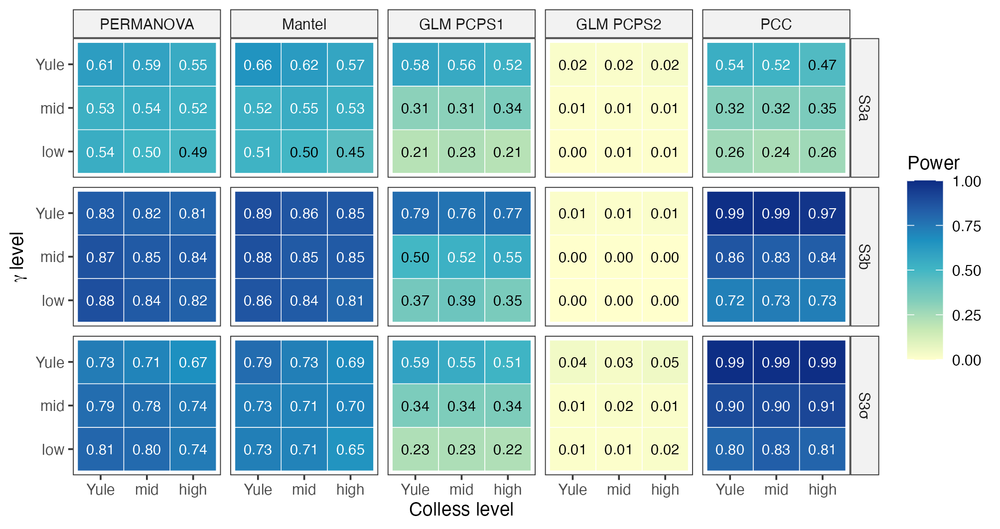

<!-- Draft of Methods and Results. Render: quarto render manuscript/methods_results.qmd
(figures in manuscript/figures/, made by analysis/13_fig1_schematic.R and
analysis/22_manuscript_figures.R; Supporting Information in
manuscript/supporting_information.qmd). Unverified references are marked
[CITAR: ...]. Numbers come from data/derived/ (see docs/MEMORIA_PROJETO.md). -->

# Abstract

1. Tests relating the phylogenetic structure of metacommunities to environmental gradients, such as the principal coordinates of phylogenetic structure (PCPS) and the phylogenetic community composition approach (PCC), were validated with static simulations on trees close to Yule. However, real phylogenies vary in imbalance and branching times, and dispersal and competition assemble metacommunities.

2. We simulated metacommunities on a grid of tree shapes that crossed the distribution of branching times (γ) with topological imbalance (Colless index), with levels from anuran clades, in static simulations reproducing the original validations and process-based simulations with species sorting, mass effects and phylogenetic competition. We modelled the type I error and power of six tests, and clade recovery by four methods, with beta-binomial models.

3. Tree imbalance did not affect the type I error of any test. When only niche breadth carried phylogenetic signal, the linear model on the second PCPS axis rejected in up to 0.36 of replicates with low γ and 200 species, and the PCC in up to 0.22. With 100 species, low γ reduced the power of the linear model on the first PCPS axis by 0.42 and that of the PCC by 0.27, but not that of PERMANOVA. With uniform dispersal, mass effects reduced the power of every test except the second PCPS axis by 0.56–0.97 and almost abolished that of the PCC; with distance-limited dispersal the losses were smaller, and the PCC kept its power with abundance data. With the largest shift, evoPCA and phylofactorization recovered a planted clade in 0.44–0.88 of replicates on average, regardless of γ, whereas PCPS depended strongly on γ and PCC rarely found the clade.

4. Performance seems to depend on branching times and on the assembly process rather than on tree imbalance, and three regional anuran pools fell at moderate levels of the grid. We recommend reporting γ of the analysed tree, not relying on a single test, not reading a significant second PCPS axis or PCC as evidence of conserved optima, considering abundance data for the PCC, and using evoPCA or phylofactorization to identify clades associated with a gradient.

Data and code availability for review: the code, the rates aggregated by condition and the scripts that reproduce every table and figure are available in an anonymized archive for review (https://doi.org/10.5281/zenodo.23500660); the public repository and its Zenodo archive will be cited after review.

Keywords: γ statistic, metacommunity phylogenetics, phylogenetic fuzzy weighting, phylogenetic signal, simulation study, species sorting, tree balance, type I error

# Introduction

The phylogenetic composition of communities along environmental gradients carries information about how lineages respond to the environment and how metacommunities are assembled (Leibold et al., 2010). Several methods relate the phylogenetic structure of a metacommunity to an environmental gradient. Phylogenetic fuzzy weighting summarizes each site by the phylogeny-weighted composition of its species, the matrix $\mathbf{P}$, whose principal coordinates of phylogenetic structure (PCPS) can then be related to the gradient (Pillar & Duarte, 2010; Duarte, 2011; Duarte et al., 2016). The phylogenetic community composition approach (PCC) relates species composition to phylogenetic eigenvectors and the gradient (Peres-Neto & Kembel, 2015), whereas evolutionary principal component analysis (evoPCA) and phylofactorization treat branches as units and point to the lineages that drive differences among sites (Pavoine, 2016; Washburne et al., 2017, 2019). These methods have been applied to plants and to animals, including the amphibians of the Americas, where the association between climate and phylogenetic composition depended on the depth of the nodes considered (Duarte et al., 2012, 2014).

The validation of these methods has focused on the type I error of permutation tests. When either the phylogeny or the environment alone structures species distributions, tests that permute only sites or only species reject the null hypothesis too often, and the largest of the two P-values (max test) is needed to control the type I error (ter Braak et al., 2012; Peres-Neto & Kembel, 2015; Duarte et al., 2016). The same problem affects tests on community-weighted means (Peres-Neto et al., 2017; Zelený, 2018), whose type I error also increases when traits and species distributions carry phylogenetic signal (Duarte et al., 2018). However, the simulations that validated phylogenetic fuzzy weighting, the PCC and phylogenetic dissimilarity tests drew species niches from a static Gaussian response model (Peres-Neto et al., 2012), on trees from a pure-birth process (Peres-Neto & Kembel, 2015; Duarte et al., 2016; Pavoine, 2016), and with niche breadth independent of the phylogeny (Peres-Neto & Kembel, 2015; Duarte et al., 2016; Peres-Neto et al., 2017). Real phylogenies and real metacommunities depart from each of these assumptions.

First, the topology of real trees departs from the Yule model (Heard, 1992; Blum & François, 2006), and a slowdown in diversification towards the present, that is, a negative γ statistic (Pybus & Harvey, 2000), was found in most clades of a large compilation of phylogenies (McPeek, 2008). Anurans are a likely case, since most living frogs descend from a few lineages that radiated rapidly in the late Cretaceous and early Paleogene (Roelants et al., 2007; Feng et al., 2017). These macroevolutionary processes also shape the phylogenetic structure of the species pools from which local communities are assembled, and through them that of the communities themselves (Gerhold et al., 2018). The size and topology of the tree change the expected values of phylogenetic signal indices (Münkemüller et al., 2012), the distribution of branch lengths changes whether community metrics, which weight different phylogenetic depths, detect clustering (Mazel et al., 2016), and topology determines how many phylogenetic eigenvectors are retained (Diniz-Filho et al., 1998), which are what PCPS and the PCC summarize. Nonetheless, to our knowledge, no study has evaluated how the distribution of branching times and the imbalance of the tree affect tests on phylogeny-weighted composition. Second, species are not sorted along gradients in isolation. In metacommunities, dispersal and competition interact with environmental filtering (Leibold et al., 2004), and high dispersal homogenizes composition among sites (Mouquet & Loreau, 2003). Dispersal can alter the outcome of community phylogenetic tests (Kembel, 2009; Mason & Pavoine, 2013), and inferring assembly from diversity patterns requires accounting for these processes (Münkemüller et al., 2020). Process-based models now generate species sorting, mass effects and competition from local population dynamics and dispersal (Thompson et al., 2020), which allows these methods to be evaluated under the processes they are meant to detect.

Third, a significant association between phylogenetic composition and the environment does not tell which lineages are responsible for it. Identifying the clades that respond to a gradient is a recurrent aim of metacommunity phylogenetics (Parra et al., 2010; Borregaard et al., 2014), and PCPS has been used for that purpose by examining the nodes associated with its axes (Duarte et al., 2012). However, to our knowledge, how often PCPS, PCC and branch-wise methods identify the correct clade, and whether this depends on tree shape, has not been evaluated with a known answer.

Here, we evaluate tests and methods that relate phylogenetic composition to environmental gradients with a simulation study designed following the aims, data-generating mechanisms, estimands, methods and performance measures structure (DiRenzo et al., 2023; Williams et al., 2024). Our aims were (i) to estimate how the distribution of branching times (γ; Pybus & Harvey, 2000) and the imbalance of the topology (the Colless index; Colless, 1982) affect the type I error and power of these tests, including under phylogenetic signal in niche breadth or maximum abundance; (ii) to estimate how the same tests perform under species sorting, mass effects and phylogenetic competition; and (iii) to estimate how well ordination and factorization methods recover a clade associated with the gradient. We expected that (i) tree imbalance would move the type I error of the taxa shuffle away from the nominal level, since the phylogenetic weights of matrix $\mathbf{P}$ are heterogeneous among tips in imbalanced trees (H1); (ii) phylogenetic signal in niche breadth or maximum abundance would inflate the type I error of all tests, with a magnitude that depends on tree shape (H2); (iii) very negative γ, that is, long internal branches near the root, would concentrate variation on the first PCPS axis and favour the recovery of basal over recent clades (H3); and (iv) the ranking of the methods in power and in clade recovery would change with tree shape (H4). Finally, we placed real regional pools of anurans on the simulated grid of tree shapes and applied all methods to three tadpole metacommunities (Appendix S3).

# Methods

## Overview of the simulation study

We generated metacommunities with two kinds of simulations (@fig-design). The static simulations follow the protocol of Peres-Neto et al. (2012), which was also used to validate the tests we evaluated, so our results can be compared directly with the published ones. The process-based simulations reproduce metacommunity dynamics with the framework of Thompson et al. (2020), in which species sorting, mass effects and competition emerge from local population dynamics and dispersal. The study was not registered, but we committed the design and hypotheses to the code repository before the main runs (16 October 2026), and we report the departures from that plan in Appendix S1.

{#fig-design width=85%}

## Tree shapes

We controlled γ and the Colless index independently by generating topology and branching times from separate processes. We drew topologies from Aldous's β-splitting model (Aldous, 1996), in which $\beta = 0$ gives Yule trees and smaller values give increasingly imbalanced trees, and branching times from a pure-birth process in which each of the $k$ lineages diversifies at rate $k^{c}$, so that $c = 0$ corresponds to a Yule process and $c < 0$ to a slowdown in diversification, which produces negative γ. Because γ depends only on the intervals between nodes and the Colless index only on the topology, this construction controls the two axes separately (Appendix S1). We took the levels of the grid from the anuran clades with 40–250 tips of the time-calibrated species-level tree of Portik et al. (2023), with the Colless index normalized against its Yule expectation and both statistics computed with the R package treestats v. 1.71.13 (Janzen & Etienne, 2024). For each pool size N (50, 100 and 200 species, as in Duarte et al., 2016), γ took three levels, namely zero (as in a Yule tree), the median of the empirical clades and their 10% quantile, and the Colless index took three levels, zero, the median and the 90% quantile (Table S1). Thus, the 3 × 3 grid spans the anuran tree shapes between the 10% and 90% quantiles. Because γ scales with the number of tips, the low level of γ became more negative with N (Table S1), so part of any change with N may reflect a more extreme low level. We drew 1,000 trees per cell and N, and replicate $r$ of every scenario used tree $r$ of its cell, so that the scenarios were paired by tree.

## Static simulations

Each metacommunity had 100 sites along an environmental gradient $E$ drawn from a uniform distribution between 0 and 100. The expected abundance of species $j$ at site $i$ followed a Gaussian response,

$$L_{ij} = h_j \exp\left[-\frac{(E_i - u_j)^2}{2\sigma_j^2}\right],$$

and we drew the observed abundance from a Poisson distribution with mean $L_{ij}$ (Peres-Neto et al., 2012). We simulated the optimum $u_j$ as a continuous trait on the tree under Brownian motion transformed by Pagel's λ (Pagel, 1999) and rescaled it to the interval [−1, 101]; niche breadth $\sigma_j$ came from a normal distribution with mean 10 and standard deviation 10, truncated at zero, and maximum abundance $h_j$ from a uniform distribution between 0 and 30. In addition, $\sigma_j$ and $h_j$ could carry phylogenetic signal, with the same marginal distribution as without signal, so that the two cases differed only in how the values were arranged on the tree (Appendix S1). We removed empty sites and pruned absent species from the tree before analysis, as one would with real data, and analysed both incidence and abundance data. Since tree shape changes both the optima and the tree analysed, we repeated the power scenarios with the same evenly spaced optima in every tree (Appendix S1).

## Process-based simulations

The process-based simulations followed the equations of Thompson et al. (2020), which we implemented in R. Growth was a Gaussian function of the mismatch between $u_j$ and $E_i$, with breadth $\sigma_j$ and maximum $r_j$, and competition followed a Beverton–Holt model (Beverton & Holt, 1957; Appendix S1). Abundances were drawn from a Poisson distribution, and a proportion $a$ of the individuals dispersed uniformly among sites, which keeps sites exchangeable and the site shuffle valid; after 1,000 steps, we analysed the final state as incidence data. We crossed two dispersal regimes with two competition structures, giving four archetypes. Dispersal was low ($a = 0.01$) in species sorting and high ($a = 0.5$) in mass effects, and competition was either intraspecific only or also interspecific and structured by phylogeny, so that close relatives competed more strongly. Since competition and dispersal remove species, the cell of the grid defined the tree of the regional pool rather than that of the analysed metacommunity, and we calibrated the pool size so that about N species were left after the dynamics (Appendix S1); mass effects with phylogenetic competition could not reach N = 200, and we dropped this combination. These simulations used five cells of the grid (the four corners and the centre) and 1,000 replicates per combination. We also ran a spatial version at N = 100, with sites on a torus, a spatially autocorrelated gradient, distance-limited dispersal and torus translations instead of the site shuffle, analysed with incidence and abundance data (Appendix S1).

## Scenarios and estimands

The eight trait scenarios were the same in both kinds of simulation (@tbl-scenarios). S0 and S1 used a gradient independent of the one that generated the data, and S2 used the generating gradient with no phylogenetic signal in any attribute of the species, so the null hypothesis of the max test was true and the rejection rate is the type I error. In S2σ and S2h, only niche breadth or maximum abundance carried phylogenetic signal. Both null hypotheses were then false, but a significant test would still be read as evidence that lineages track the gradient through their optima, since no permutation of the tips can separate signal in the optima from signal in the other attributes. We therefore report the rejection rate in these two scenarios as the probability that a test suggests conserved optima when they are not conserved, and not as a type I error. The rejection rate in S3a–S3σ is the power. For aim (iii), the estimand was the probability that a method identifies a planted clade.

| Scenario | Optima (λ) | Signal in σ or h | Gradient analysed | Null hypothesis of the max test | Estimand |
|---|---|---|---|---|---|
| S0 | 0 | none | independent | true | type I error |
| S1 | 1 | none | independent | true | type I error |
| S2 | 0 | none | generating | true | type I error |
| S2σ | 0 | σ | generating | false | rejection with conserved σ only |
| S2h | 0 | h | generating | false | rejection with conserved h only |
| S3a | 0.5 | none | generating | false | power |
| S3b | 1 | none | generating | false | power |
| S3σ | 1 | σ | generating | false | power with conserved σ |

: Trait scenarios of the static and process-based simulations. λ is Pagel's λ of the species optima. {#tbl-scenarios}

## Methods compared

All tests relate the matrix $\mathbf{P}$ of phylogeny-weighted species composition (Pillar & Duarte, 2010; Duarte et al., 2016), or the phylogenetic eigenvectors, to the gradient. We computed $\mathbf{P}$ with phylogenetic fuzzy weighting and the square-rooted Bray–Curtis dissimilarity between sites ($D_P$), and tested its association with $E$ with a permutational multivariate analysis of variance (PERMANOVA; Anderson, 2001) and a Mantel test (Mantel, 1967), as in Duarte et al. (2016). We also extracted the principal coordinates of phylogenetic structure (PCPS; Duarte, 2011; Duarte et al., 2012) from $D_P$ and fitted a linear model of each of the first two axes on $E$ (GLM PCPS1 and GLM PCPS2); in the process-based simulations, we also fitted a redundancy analysis of both axes on $E$ (RDA PCPS). We re-implemented the phylogenetic community composition approach (PCC) of Peres-Neto and Kembel (2015) from the equations in the original article, using the variance of the adjusted R² across phylogenetic eigenvectors as the test statistic. Every test was evaluated with 999 permutations under two null models: the site shuffle permutes the sites, under the null hypothesis that $\mathbf{P}$ is independent of $E$, and the taxa shuffle permutes the tips of the tree while keeping its topology, under the null hypothesis that species are exchangeable on the tree, that is, that none of $u_j$, $\sigma_j$ and $h_j$ carries phylogenetic signal. We report the largest of the two P-values (max test), which controls the type I error when either null hypothesis holds (Peres-Neto & Kembel, 2015; Duarte et al., 2016). We checked our permutation code against the R packages vegan and PCPS (Appendix S1). In a second run of the static simulations, we also evaluated the RDA PCPS and a variant of the GLM on PCPS axes with symmetric Procrustes of the null axes onto the observed ones, as in the R package PCPS (Appendix S2). Unless stated otherwise, results for PCPS refer to the GLM on single axes without this rotation.

## Recovery of a planted clade

To evaluate aim (iii), we planted a clade associated with the gradient in each replicate of the static simulations. We drew one internal node whose clade held 10–30% of the tips, either among the older or among the younger half of the eligible nodes, so that basal and recent clades of similar size could be compared. The optima of all species were

$$u_j = -1 + 102\,\Phi(z_j + \delta I_j),$$

where $z_j$ are independent standard normal deviates, $I_j$ indicates membership of the planted clade, $\delta$ is the shift and Φ is the standard normal distribution function; the other species therefore had no phylogenetic signal in their optima, and the shift has the same meaning for every tree size. We used shifts of 0 (no planted effect, which gives the chance level of each method), 0.5, 1 and 2, all nine cells of the grid, N = 50, 100 and 200 with incidence data, and N = 100 with abundance data, with 1,000 replicates per combination (Appendix S1). We compared PCPS, PCC, the evolutionary principal component analysis (evoPCA; Pavoine, 2016), computed with the R package adiv v. 2.2.1 (Pavoine, 2020), and phylofactorization (Washburne et al., 2017). Each method gave a score to every internal node: for the three ordinations, the absolute correlation between membership of its clade and the species scores on the axis most correlated with $E$ among the first four, and for phylofactorization the objective of the algorithm (Appendix S1). A method recovered the clade when its best-scoring clade was the planted one or its complement. At N = 100, we also chose the axis among the first two or eight, restricted the objective of phylofactorization to the interaction between the split and $E$, and added a planted clade that differed only in prevalence (Appendix S1).

## Performance measures and statistical models

The performance measures were the rejection rate of each test and the proportion of hits of each clade-recovery method across the $K = 1{,}000$ replicates of a condition. The Monte Carlo standard error of a rate $p$ is $\sqrt{p(1 - p)/K}$, which is 0.007 at $p = 0.05$, so a 95% Monte Carlo interval around the nominal level falls within Bradley's liberal criterion for acceptable type I error, [0.025, 0.075] (Bradley, 1978); every rate and its Monte Carlo standard error are in Table S2. We then modelled the rates aggregated by condition with beta-binomial models fitted in the R package brms v. 2.23.0 (Bürkner, 2017) with CmdStan v. 2.39.0 through cmdstanr v. 0.9.0 (Gabry et al., 2025), with one model for the type I error and one for the power in each kind of simulation, and one for clade recovery. We entered the levels of γ and of the Colless index as factors, with their interaction, which estimates the full γ × imbalance surface without assuming its form, and let the shape effects differ among tests (or methods), scenarios, N and data type (Appendix S1). Priors were declared explicitly on the logit scale, weakly informative and centred on a rate of 0.05 for the intercepts of the type I models (Appendix S1). We checked the priors with prior predictive simulations and assessed the sensitivity of the posteriors to them by power-scaling with the R package priorsense v. 1.4.0 (Kallioinen et al., 2024),. We checked convergence with the rank-normalized $\hat{R}$, the bulk and tail effective sample sizes and the numbers of divergent transitions and of transitions at the maximum tree depth, and model fit with posterior predictive checks. We treat the raw rates and their Monte Carlo contrasts, which respect the pairing of the design, as the primary evidence and the posterior medians and 95% credible intervals (CI) of the models as a synthesis, and report the raw contrasts where the two differ.

## Empirical reference and case study

We computed γ and the normalized Colless index of three nested regional pools of anurans built from 14 tadpole metacommunities, and applied all methods to three published tadpole metacommunities (Appendix S3).

## Implementation and reproducibility

We ran all analyses in R v. 4.6.1 (R Core Team, 2026), with the versions of every package recorded in the lockfile of renv v. 1.3.1 (Ushey & Wickham, 2026); trees were handled with ape v. 5.8-1 (Paradis & Schliep, 2019). The simulation pipeline, its computing environment and its seeds are described in Appendix S1. Code is available in an anonymized archive for review (https://doi.org/10.5281/zenodo.23500660), together with the aggregated rates and the scripts that reproduce every table and figure without rerunning the simulations.

# Results

The static simulations reproduced the published validations, since 66 of 72 rejection rates of Duarte et al. (2016) fell within the 95% binomial interval of our estimates and the PCC matched the rates of Peres-Neto and Kembel (2015) where they do not depend on the tree (Appendix S2). All formal models converged ($\hat{R}$ ≤ 1.01, no divergent transitions), and their posterior predictive intervals covered the observed rates (Appendix S2, Table S3). The predicted rates were largely insensitive to the priors; the beta-binomial medians of single conditions departed from the raw rates by up to 0.13, but the model contrasts agreed with the raw ones in every conclusion below (Appendix S2).

Tree imbalance did not affect the type I error of any test (@fig-type1). In all 75 combinations of test, scenario from S0 to S2h and N, the difference in the distance of the rejection rate from the nominal level between highly imbalanced and Yule trees was within ±0.012 (±0.017 in raw rates), and no 95% CI excluded zero, with incidence or abundance data; four of 150 raw Monte Carlo intervals did, fewer than expected by chance. The posterior probability of a change smaller than 0.025 exceeded 0.95 in 297 of 300 conditions (Appendix S2). Therefore, H1 was not supported at the resolution of our design.

Phylogenetic signal in niche breadth increased the rejection rate of only two tests (@fig-type1), even though the optima had no phylogenetic signal. Compared with the same scenario without signal (S2), and paired by tree, signal in σ (S2σ) increased the rejection rate of GLM PCPS2 by 0.03 (95% Monte Carlo interval 0.01–0.05) in Yule trees at N = 100, and by 0.04 (0.01–0.06), 0.11 (0.09–0.14) and 0.30 (0.27–0.33) with low γ at N = 50, 100 and 200, with raw rates of up to 0.36. The PCC increased by 0.08 (0.06–0.10) in Yule trees and by 0.04 (0.02–0.06) with low γ at N = 100, with raw rates of up to 0.22. In contrast, PERMANOVA, GLM PCPS1 and the Mantel test became more conservative under signal in σ (by 0.005–0.030), and signal in maximum abundance (S2h) did not change the rejection rate of any test. The RDA PCPS rejected in 0.004–0.021 of the replicates in S2σ, whereas rotating the null axes by Procrustes removed the increase of GLM PCPS2 but made it conservative (Appendix S2). As a result, H2 was rejected as stated.

{#fig-type1 width=100%}

The distribution of branching times, but not imbalance, changed the power of most tests (@fig-power). At N = 100 in S3b, low γ reduced the power of GLM PCPS1 from 0.79 to 0.37 (raw contrast −0.42, 95% Monte Carlo interval −0.46 to −0.38) and that of the PCC from 0.99 to 0.72 (−0.27, −0.30 to −0.24), whereas the power of PERMANOVA did not decrease (0.05, 0.02 to 0.08), and high imbalance reduced power by at most 0.13 (raw rates). Consequently, the ranking of the tests changed with tree shape, since in S3b the PCC was the most powerful test in Yule trees and the third with low γ. Thus, H4 was supported for power. In the second run, the RDA PCPS lost much less power with low γ than GLM PCPS1 (posterior medians 0.65 against 0.76 in Yule trees, and 0.34 against 0.74, at N = 100 in S3b; Appendix S2). With the optima given the same distribution in every tree, low γ still reduced the power of GLM PCPS1 (from 0.77 to 0.25) and of the PCC (from 0.99 to 0.80), and not that of PERMANOVA (raw rates at N = 100 in S3b; Appendix S2).

{#fig-power width=100%}

The assembly process mattered more than tree shape for power (@fig-layerB). Mass effects reduced the power of every test except GLM PCPS2, by 0.56 (GLM PCPS1) to 0.97 (PCC; 95% Monte Carlo interval 0.96–0.98) in Yule pool trees, so that the PCC detected the phylogenetic signal in almost no replicates. Surprisingly, adding phylogenetic competition to mass effects partly restored the power of every test except the PCC; for instance, PERMANOVA lost 0.46 (0.42–0.50) instead of 0.57 (0.54–0.61). However, competition pruned close relatives, which made the γ of the analysed tree more negative and its Colless index lower than those of the pool, especially under mass effects (Appendix S2). In S0–S2h, no lower CI bound exceeded 0.075 at N = 100, but raw rates of GLM PCPS2 in S2σ and of the PCC in S2h did at N = 100 and 200 (Appendix S2). With spatial structure, more power was retained under mass effects (PERMANOVA 0.54 against 0.29 in Yule pool trees), except for the PCC with incidence data (0.02; 0.98 with abundance data), and low γ had the same effect as without it (Appendix S2).

{#fig-layerB width=100%}

The evoPCA and phylofactorization recovered the planted clade far more often than PCPS and PCC (@fig-clade). With a shift of 2 and incidence data, and averaged over the cells of the grid, evoPCA and phylofactorization identified the planted node in 0.44–0.88 of the replicates, depending on N and depth, PCPS in 0.12–0.42 (0.02–0.71 in single cells) and PCC in only 0.08–0.12 (Appendix S2). Without a planted effect, recovery was 0.003–0.021 for evoPCA and phylofactorization and 0.018–0.050 for PCPS and PCC, so the PCC recovered the planted clade only about two to three times more often than by chance even with the largest shift (Appendix S2).

Tree shape changed recovery only for PCPS and PCC. With low γ, PCPS recovered basal clades in 0.61 of the replicates against 0.22 in Yule trees, and recent clades in 0.34 against 0.04 (N = 100), whereas the recovery of evoPCA and phylofactorization did not change with γ (all 95% CI included zero), and high imbalance reduced recovery by 0.01–0.12 in all methods. Since low γ improved PCPS for recent as well as for basal clades, H3 was only partly supported, and H4 was supported for clade recovery through the change in rank between PCPS and PCC. The number of axes did not change the recovery by evoPCA or PCPS and changed that of the PCC by at most 0.06. However, the default objective of phylofactorization recovered a clade that differed only in prevalence in 0.07–0.12 of the replicates, against 0.001–0.004 when restricted to the interaction with $E$, which recovered planted clades as often (Appendix S2).

{#fig-clade width=100%}

# Discussion

Tree imbalance did not affect the type I error of any test, nor that of the taxa shuffle alone. This agrees with comparative methods, in which randomization tests of phylogenetic signal keep the nominal level (Blomberg et al., 2003), whereas the size and topology of the tree change the expected values of the statistics (Münkemüller et al., 2012). Contrary to H1, the heterogeneous weights of imbalanced trees therefore seem not to bias the permutation null distributions. As a result, imbalance alone does not seem to be a reason to distrust the type I error of tests on phylogeny-weighted composition.

Very negative γ reduced the power of the GLM on the first PCPS axis and of the PCC, whereas PERMANOVA was less sensitive to it. The topology of the tree determines how many phylogenetic eigenvectors are needed to describe it (Diniz-Filho et al., 1998), and in trees with long internal branches near the root a few deep splits probably dominate the leading eigenvectors, so the first PCPS axis and the eigenvectors of the PCC may capture the deepest dichotomy even when the gradient sorts species along another one, although the share of variation on the first PCPS axis decreased rather than increased with low γ (Appendix S2). The RDA on the first two PCPS axes lost much less power, and the loss of the single-axis tests persisted when the optima had the same marginal distribution in every tree, so it is not explained by that distribution alone. However, related species still had similar optima in that run, and we did not record the eigenvalue spectra of each replicate, so we cannot separate the effect of γ on the analysis from its effect on the arrangement of the optima on the tree. Taken together, tests on single phylogenetic axes seem to be fragile when the tree has very negative γ.

Phylogenetic signal in niche breadth increased the rejection rate of only the second PCPS axis and the PCC, even though the optima had no phylogenetic signal, which previous evaluations could not detect because they drew niche breadth independently of the phylogeny (Duarte et al., 2016, 2018; Peres-Neto et al., 2017). Strictly, these rejections are not type I errors, since conserved σ violates the exchangeability of species assumed by the taxa shuffle as much as conserved optima do, and permutation tests reject whenever the randomization breaks down a structure of the data, whether or not it is the one of interest (Hardy, 2008). However, the practical consequence is the same, because a significant test is usually read as evidence that lineages track the gradient through their optima. With conserved σ, the second PCPS axis became more correlated with the gradient itself, whereas its correlation with the square of the gradient did not increase (Appendix S2). This pattern seems to load on the axis orthogonal to the basal contrast of the first PCPS axis, which would explain why the increase was largest with low γ and 200 species. Rotating the null axes by Procrustes removed this increase but made the test conservative, whereas the RDA on both axes stayed below the nominal level (Appendix S2). Thus, a significant second PCPS axis or PCC should not be taken as evidence of conserved optima when niche breadth may be phylogenetically conserved, and constrained randomizations (Braga et al., 2018) or model-based tests with phylogenetic random effects (Li & Ives, 2017; Tsang & Cadotte, 2025) seem to be promising alternatives.

With uniform dispersal, mass effects reduced the power of every test except GLM PCPS2 and almost abolished that of the PCC. This is expected from source–sink theory, in which high dispersal homogenizes composition among sites (Mouquet & Loreau, 2003), and it agrees with the low power of phylogenetic diversity indices under mass and priority effects even with strongly conserved traits (Mason & Pavoine, 2013). In spatially explicit landscapes, however, mass effects let species dominate subregions instead of homogenizing the whole metacommunity in the model of Thompson et al. (2020). Accordingly, more power was retained under mass effects in our spatial version, which suggests that uniform dispersal is a severe case. The PCC kept almost no power with incidence data even then, but not with abundance data, which suggests that its failure is tied to incidence data, in which widespread species occur almost everywhere. Consequently, a non-significant test in a metacommunity with high dispersal does not seem to indicate the absence of environmental filtering on lineages, in line with the warning that the interpretation of community phylogenetic tests should account for dispersal (Kembel, 2009).

Phylogenetic competition partly restored the power lost under mass effects for every test except the PCC, but it also changed the shape of the analysed tree. Competition pruned close relatives, so that the analysed tree had a more negative γ and a lower Colless index than the pool, especially under mass effects, and the effect of the process cannot be separated from that of the change in tree shape. Moreover, our competition kernel imposed the assumptions that trait similarity causes stronger competition and that competition causes exclusion, which are weakly supported as general rules (Gerhold et al., 2015). Indeed, relatedness was a weak or inconsistent predictor of competitive outcomes in plants (Cahill et al., 2008; Godoy et al., 2014), and competition can also exclude less related taxa (Mayfield & Levine, 2010). Therefore, this result should be read as an upper bound for a particular competition structure rather than as a general effect of competition.

The evoPCA and phylofactorization recovered the planted clade far more often than PCPS and PCC, and independently of γ. Phylofactorization evaluates every edge of the tree (Washburne et al., 2017, 2019) and evoPCA treats every branch as a variable whose abundances enter the ordination (Pavoine, 2016), so the stem branch of the planted clade is always a candidate, whatever the distribution of node depths. In contrast, the PCC tests a global association between phylogenetic eigenvectors, composition and environment (Peres-Neto & Kembel, 2015), and its leading eigenvectors rarely isolated the clade of interest. Thus, branch-wise methods seem to be the appropriate choice to identify which clades respond to a gradient, provided that the objective of phylofactorization does not reward differences in prevalence unrelated to it.

Low γ improved the recovery of both basal and recent clades by PCPS, so H3 was only partly supported. Empirical applications of PCPS found that environmental effects concentrate on a few nodes (Duarte et al., 2012) and that deep and shallow nodes respond to different drivers in amphibians (Duarte et al., 2014). Our results suggest that which of these nodes PCPS can detect depends on the distribution of node depths, since PCPS probably recovers a clade only when its stem node is among those weighted by the leading axes. Older clades were also recovered more often by PCPS within each level of γ and depth class, so the effect of clade age is not only an effect of γ, but the share of variation on the first PCPS axis decreased rather than increased with low γ (Appendix S2), which contradicts the mechanism behind H3. As a consequence, the advantage of basal clades under PCPS seems to be a matter of degree, and the nodes highlighted by PCPS axes in empirical studies should be interpreted in light of the shape of the tree.

The three regional pools of anurans fell between the Yule and median levels of γ of our grid (Appendix S3). Negative γ is common in empirical phylogenies (McPeek, 2008; Phillimore & Price, 2008), but γ is also sensitive to incomplete and nonrandom sampling of lineages (Cusimano & Renner, 2010; Brock et al., 2011), so we used it only as a descriptor of tree shape, not as evidence of a diversification process. Therefore, the low-γ cells, where the effects of tree shape were largest, are more extreme than these pools, although they lie within the range of anuran clades.

Our study also has limitations, since (i) the grid had no level with γ > 0; (ii) the spatial version covered only N = 100, with an approximate redistribution of dispersers; (iii) we did not vary the number of sites or the length of the gradient; and (iv) the case study, with 13–40 ponds and no significant association, illustrates rather than validates the methods. To the best of our knowledge, this is the first simulation study to evaluate tests on phylogeny-weighted composition across controlled gradients of tree shape and under process-based metacommunity assembly. In summary, we recommend that empirical studies (i) report γ and the normalized Colless index of the analysed tree; (ii) not rely on a single test, and prefer PERMANOVA or the RDA on the first two PCPS axes, with the max test, to tests on single axes or eigenvectors when γ is very negative; (iii) not take a significant second PCPS axis or PCC as evidence of conserved optima when niche breadth may be phylogenetically conserved; (iv) not read a lack of power under high dispersal as evidence against niche-based assembly, and consider abundance data for the PCC; and (v) use evoPCA, or phylofactorization with an objective restricted to the interaction with the gradient, rather than PCPS axes, to identify the clades associated with a gradient.

# References

Aldous, D. (1996). Probability distributions on cladograms. In D. Aldous & R. Pemantle (Eds.), *Random discrete structures* (pp. 1–18). The IMA Volumes in Mathematics and its Applications, Vol. 76. Springer. https://doi.org/10.1007/978-1-4612-0719-1_1

Anderson, M. J. (2001). A new method for non-parametric multivariate analysis of variance. *Austral Ecology*, 26, 32–46. https://doi.org/10.1111/j.1442-9993.2001.01070.pp.x

Beverton, R. J. H., & Holt, S. J. (1957). *On the dynamics of exploited fish populations*. Fishery Investigations Series II, Vol. 19. London: HMSO (reprinted 1993, Springer, https://doi.org/10.1007/978-94-011-2106-4)

Blomberg, S. P., Garland, T., & Ives, A. R. (2003). Testing for phylogenetic signal in comparative data: behavioral traits are more labile. *Evolution*, 57, 717–745. https://doi.org/10.1111/j.0014-3820.2003.tb00285.x

Blum, M. G. B., & François, O. (2006). Which random processes describe the tree of life? A large-scale study of phylogenetic tree imbalance. *Systematic Biology*, 55, 685–691. https://doi.org/10.1080/10635150600889625

Borregaard, M. K., Rahbek, C., Fjeldså, J., Parra, J. L., Whittaker, R. J., & Graham, C. H. (2014). Node-based analysis of species distributions. *Methods in Ecology and Evolution*, 5, 1225–1235. https://doi.org/10.1111/2041-210X.12283

ter Braak, C. J. F., Cormont, A., & Dray, S. (2012). Improved testing of species traits–environment relationships in the fourth-corner problem. *Ecology*, 93, 1525–1526. https://doi.org/10.1890/12-0126.1

ter Braak, C. J. F., Peres-Neto, P. R., & Dray, S. (2017). A critical issue in model-based inference for studying trait-based community assembly and a solution. *PeerJ*, 5, e2885. https://doi.org/10.7717/peerj.2885

Bradley, J. V. (1978). Robustness? *British Journal of Mathematical and Statistical Psychology*, 31, 144–152. https://doi.org/10.1111/j.2044-8317.1978.tb00581.x

Braga, J., ter Braak, C. J. F., Thuiller, W., & Dray, S. (2018). Integrating spatial and phylogenetic information in the fourth-corner analysis to test trait–environment relationships. *Ecology*, 99, 2667–2674. https://doi.org/10.1002/ecy.2530

Brock, C. D., Harmon, L. J., & Alfaro, M. E. (2011). Testing for temporal variation in diversification rates when sampling is incomplete and nonrandom. *Systematic Biology*, 60, 410–419. https://doi.org/10.1093/sysbio/syr007

Bürkner, P.-C. (2017). brms: an R package for Bayesian multilevel models using Stan. *Journal of Statistical Software*, 80(1), 1–28. https://doi.org/10.18637/jss.v080.i01

Cahill, J. F., Kembel, S. W., Lamb, E. G., & Keddy, P. A. (2008). Does phylogenetic relatedness influence the strength of competition among vascular plants? *Perspectives in Plant Ecology, Evolution and Systematics*, 10, 41–50. https://doi.org/10.1016/j.ppees.2007.10.001

CNPq (Conselho Nacional de Desenvolvimento Científico e Tecnológico). (2026). Portaria CNPq nº 2.664, de 6 de março de 2026: Política de Integridade na Atividade Científica do CNPq. *Diário Oficial da União*, Seção 1, 11 March 2026, p. 4.

Colless, D. H. (1982). Review of: Phylogenetics: The theory and practice of phylogenetic systematics. *Systematic Zoology*, 31, 100–104. https://doi.org/10.2307/2413420

Cusimano, N., & Renner, S. S. (2010). Slowdowns in diversification rates from real phylogenies may not be real. *Systematic Biology*, 59, 458–464. https://doi.org/10.1093/sysbio/syq032

Diniz-Filho, J. A. F., de Sant'Ana, C. E. R., & Bini, L. M. (1998). An eigenvector method for estimating phylogenetic inertia. *Evolution*, 52, 1247–1262. https://doi.org/10.1111/j.1558-5646.1998.tb02006.x

DiRenzo, G. V., Hanks, E., & Miller, D. A. W. (2023). A practical guide to understanding and validating complex models using data simulations. *Methods in Ecology and Evolution*, 14, 203–217. https://doi.org/10.1111/2041-210X.14030

Drobniak, S. M., Cendrowska-Pek, M., Gudowska, A., Janas, K., Podkowa, P., Skorb, K., Gronowska, M., Oleś, W., Bikmurzina, F., Boroń, N., Zagalska-Neubauer, M., Nakagawa, S., Łagisz, M., Arct, A., & Rutkowska, J. (2026). A systematic map of generative AI guidelines and reporting in ecology and evolutionary biology: towards the framework of AI disclosure for Improved Transparency (AIdIT). *Research Integrity and Peer Review*, 11, 57. https://doi.org/10.1186/s41073-026-00230-1

Duarte, L. D. S. (2011). Phylogenetic habitat filtering influences forest nucleation in grasslands. *Oikos*, 120, 208–215. https://doi.org/10.1111/j.1600-0706.2010.18898.x

Duarte, L. D. S., Both, C., Debastiani, V. J., Carlucci, M. B., Gonçalves, L. O., Cappelatti, L., Seger, G. D. S., Bastazini, V. A. G., Brum, F. T., Salengue, E. V., & Bernardo-Silva, J. S. (2014). Climate effects on amphibian distributions depend on phylogenetic resolution and the biogeographical history of taxa. *Global Ecology and Biogeography*, 23, 213–222. https://doi.org/10.1111/geb.12089

Duarte, L. D. S., Debastiani, V. J., Carlucci, M. B., & Diniz-Filho, J. A. F. (2018). Analyzing community-weighted trait means across environmental gradients: should phylogeny stay or should it go? *Ecology*, 99, 385–398. https://doi.org/10.1002/ecy.2081

Duarte, L. D. S., Debastiani, V. J., Freitas, A. V. L., & Pillar, V. D. (2016). Dissecting phylogenetic fuzzy weighting: theory and application in metacommunity phylogenetics. *Methods in Ecology and Evolution*, 7, 937–946. https://doi.org/10.1111/2041-210X.12547

Duarte, L. D. S., Prieto, P. V., & Pillar, V. D. (2012). Assessing spatial and environmental drivers of phylogenetic structure in Brazilian Araucaria forests. *Ecography*, 35, 952–960. https://doi.org/10.1111/j.1600-0587.2011.07193.x

Feng, Y.-J., Blackburn, D. C., Liang, D., Hillis, D. M., Wake, D. B., Cannatella, D. C., & Zhang, P. (2017). Phylogenomics reveals rapid, simultaneous diversification of three major clades of Gondwanan frogs at the Cretaceous–Paleogene boundary. *Proceedings of the National Academy of Sciences*, 114, E5864–E5870. https://doi.org/10.1073/pnas.1704632114

Gabry, J., Češnovar, R., Johnson, A., & Bronder, S. (2025). cmdstanr: R interface to CmdStan. R package version 0.9.0. https://github.com/stan-dev/cmdstanr.

Gerhold, P., Cahill, J. F., Winter, M., Bartish, I. V., & Prinzing, A. (2015). Phylogenetic patterns are not proxies of community assembly mechanisms (they are far better). *Functional Ecology*, 29, 600–614. https://doi.org/10.1111/1365-2435.12425

Gerhold, P., Carlucci, M. B., Procheş, Ş., & Prinzing, A. (2018). The deep past controls the phylogenetic structure of present, local communities. *Annual Review of Ecology, Evolution, and Systematics*, 49, 477–497. https://doi.org/10.1146/annurev-ecolsys-110617-062348

Godoy, O., Kraft, N. J. B., & Levine, J. M. (2014). Phylogenetic relatedness and the determinants of competitive outcomes. *Ecology Letters*, 17, 836–844. https://doi.org/10.1111/ele.12289

Hardy, O. J. (2008). Testing the spatial phylogenetic structure of local communities: statistical performances of different null models and test statistics on a locally neutral community. *Journal of Ecology*, 96, 914–926. https://doi.org/10.1111/j.1365-2745.2008.01421.x

Heard, S. B. (1992). Patterns in tree balance among cladistic, phenetic, and randomly generated phylogenetic trees. *Evolution*, 46, 1818–1826. https://doi.org/10.1111/j.1558-5646.1992.tb01171.x

Janzen, T., & Etienne, R. S. (2024). Phylogenetic tree statistics: a systematic overview using the new R package treestats. *Molecular Phylogenetics and Evolution*, 200, 108168. https://doi.org/10.1016/j.ympev.2024.108168

Kallioinen, N., Paananen, T., Bürkner, P.-C., & Vehtari, A. (2024). Detecting and diagnosing prior and likelihood sensitivity with power-scaling. *Statistics and Computing*, 34, 57. https://doi.org/10.1007/s11222-023-10366-5

Kembel, S. W. (2009). Disentangling niche and neutral influences on community assembly: assessing the performance of community phylogenetic structure tests. *Ecology Letters*, 12, 949–960. https://doi.org/10.1111/j.1461-0248.2009.01354.x

Leibold, M. A., Economo, E. P., & Peres-Neto, P. (2010). Metacommunity phylogenetics: separating the roles of environmental filters and historical biogeography. *Ecology Letters*, 13, 1290–1299. https://doi.org/10.1111/j.1461-0248.2010.01523.x

Leibold, M. A., Holyoak, M., Mouquet, N., Amarasekare, P., Chase, J. M., Hoopes, M. F., Holt, R. D., Shurin, J. B., Law, R., Tilman, D., Loreau, M., & Gonzalez, A. (2004). The metacommunity concept: a framework for multi-scale community ecology. *Ecology Letters*, 7, 601–613. https://doi.org/10.1111/j.1461-0248.2004.00608.x

Li, D., & Ives, A. R. (2017). The statistical need to include phylogeny in trait-based analyses of community composition. *Methods in Ecology and Evolution*, 8, 1192–1199. https://doi.org/10.1111/2041-210X.12767

Mantel, N. (1967). The detection of disease clustering and a generalized regression approach. *Cancer Research*, 27, 209–220.

Mason, N. W. H., & Pavoine, S. (2013). Does trait conservatism guarantee that indicators of phylogenetic community structure will reveal niche-based assembly processes along stress gradients? *Journal of Vegetation Science*, 24, 820–833. https://doi.org/10.1111/jvs.12033

Mayfield, M. M., & Levine, J. M. (2010). Opposing effects of competitive exclusion on the phylogenetic structure of communities. *Ecology Letters*, 13, 1085–1093. https://doi.org/10.1111/j.1461-0248.2010.01509.x

Mazel, F., Davies, T. J., Gallien, L., Renaud, J., Groussin, M., Münkemüller, T., & Thuiller, W. (2016). Influence of tree shape and evolutionary time-scale on phylogenetic diversity metrics. *Ecography*, 39, 913–920. https://doi.org/10.1111/ecog.01694

McPeek, M. A. (2008). The ecological dynamics of clade diversification and community assembly. *The American Naturalist*, 172, E270–E284. https://doi.org/10.1086/593137

Mouquet, N., & Loreau, M. (2003). Community patterns in source-sink metacommunities. *The American Naturalist*, 162, 544–557. https://doi.org/10.1086/378857

Münkemüller, T., Gallien, L., Pollock, L. J., Barros, C., Carboni, M., Chalmandrier, L., Mazel, F., Mokany, K., Roquet, C., Smyčka, J., Talluto, M. V., & Thuiller, W. (2020). Dos and don'ts when inferring assembly rules from diversity patterns. *Global Ecology and Biogeography*, 29, 1212–1229. https://doi.org/10.1111/geb.13098

Münkemüller, T., Lavergne, S., Bzeznik, B., Dray, S., Jombart, T., Schiffers, K., & Thuiller, W. (2012). How to measure and test phylogenetic signal. *Methods in Ecology and Evolution*, 3, 743–756. https://doi.org/10.1111/j.2041-210X.2012.00196.x

Pagel, M. (1999). Inferring the historical patterns of biological evolution. *Nature*, 401, 877–884. https://doi.org/10.1038/44766

Paradis, E., & Schliep, K. (2019). ape 5.0: an environment for modern phylogenetics and evolutionary analyses in R. *Bioinformatics*, 35, 526–528. https://doi.org/10.1093/bioinformatics/bty633

Parra, J. L., McGuire, J. A., & Graham, C. H. (2010). Incorporating clade identity in analyses of phylogenetic community structure: an example with hummingbirds. *The American Naturalist*, 176, 573–587. https://doi.org/10.1086/656619

Pavoine, S. (2016). A guide through a family of phylogenetic dissimilarity measures among sites. *Oikos*, 125, 1719–1732. https://doi.org/10.1111/oik.03262

Pavoine, S. (2020). adiv: an R package to analyse biodiversity in ecology. *Methods in Ecology and Evolution*, 11, 1106–1112. https://doi.org/10.1111/2041-210X.13430

Peres-Neto, P. R., & Kembel, S. W. (2015). Phylogenetic gradient analysis: environmental drivers of phylogenetic variation across ecological communities. *Plant Ecology*, 216, 709–724. https://doi.org/10.1007/s11258-014-0405-0

Peres-Neto, P. R., Dray, S., & ter Braak, C. J. F. (2017). Linking trait variation to the environment: critical issues with community-weighted mean correlation resolved by the fourth-corner approach. *Ecography*, 40, 806–816. https://doi.org/10.1111/ecog.02302

Peres-Neto, P. R., Leibold, M. A., & Dray, S. (2012). Assessing the effects of spatial contingency and environmental filtering on metacommunity phylogenetics. *Ecology*, 93, S14–S30. https://doi.org/10.1890/11-0494.1

Phillimore, A. B., & Price, T. D. (2008). Density-dependent cladogenesis in birds. *PLoS Biology*, 6, e71. https://doi.org/10.1371/journal.pbio.0060071

Pillar, V. D., & Duarte, L. D. S. (2010). A framework for metacommunity analysis of phylogenetic structure. *Ecology Letters*, 13, 587–596. https://doi.org/10.1111/j.1461-0248.2010.01456.x

Portik, D. M., Streicher, J. W., & Wiens, J. J. (2023). Frog phylogeny: a time-calibrated, species-level tree based on hundreds of loci and 5,242 species. *Molecular Phylogenetics and Evolution*, 188, 107907. https://doi.org/10.1016/j.ympev.2023.107907

Pybus, O. G., & Harvey, P. H. (2000). Testing macro-evolutionary models using incomplete molecular phylogenies. *Proceedings of the Royal Society B*, 267, 2267–2272. https://doi.org/10.1098/rspb.2000.1278

R Core Team (2026). *R: a language and environment for statistical computing*. Vienna: R Foundation for Statistical Computing. https://doi.org/10.32614/R.manuals

Roelants, K., Gower, D. J., Wilkinson, M., Loader, S. P., Biju, S. D., Guillaume, K., Moriau, L., & Bossuyt, F. (2007). Global patterns of diversification in the history of modern amphibians. *Proceedings of the National Academy of Sciences*, 104, 887–892. https://doi.org/10.1073/pnas.0608378104

Thompson, P. L., Guzman, L. M., De Meester, L., Horváth, Z., Ptacnik, R., Vanschoenwinkel, B., Viana, D. S., & Chase, J. M. (2020). A process-based metacommunity framework linking local and regional scale community ecology. *Ecology Letters*, 23, 1314–1329. https://doi.org/10.1111/ele.13568

Tsang, T. P. N., & Cadotte, M. W. (2025). Species overlap and phylogenetic relatedness result in community statistical non-independence (and what to do about it). *Ecology Letters*, 28, e70267. https://doi.org/10.1111/ele.70267

Ushey, K., & Wickham, H. (2026). renv: project environments. R package version 1.3.1. https://doi.org/10.32614/CRAN.package.renv

Washburne, A. D., Silverman, J. D., Leff, J. W., Bennett, D. J., Darcy, J. L., Mukherjee, S., Fierer, N., & David, L. A. (2017). Phylogenetic factorization of compositional data yields lineage-level associations in microbiome datasets. *PeerJ*, 5, e2969. https://doi.org/10.7717/peerj.2969

Washburne, A. D., Silverman, J. D., Morton, J. T., Becker, D. J., Crowley, D., Mukherjee, S., David, L. A., & Plowright, R. K. (2019). Phylofactorization: a graph partitioning algorithm to identify phylogenetic scales of ecological data. *Ecological Monographs*, 89, e01353. https://doi.org/10.1002/ecm.1353

Williams, C., Yang, Y., Lagisz, M., Morrison, K., Ricolfi, L., Warton, D. I., & Nakagawa, S. (2024). Transparent reporting items for simulation studies evaluating statistical methods: foundations for reproducibility and reliability. *Methods in Ecology and Evolution*, 15, 1926–1939. https://doi.org/10.1111/2041-210X.14415

Zelený, D. (2018). Which results of the standard test for community-weighted mean approach are too optimistic? *Journal of Vegetation Science*, 29, 953–966. https://doi.org/10.1111/jvs.12688

# AI disclosure statement

<!-- AIdIT v0.1 format (Drobniak et al. 2026, doi:10.1186/s41073-026-00230-1;
sentences generated following the template of the official app,
github.com/szymekdr/AI_reporting, code/app.R, checked 2026-10-21). Engines,
areas of use, dates and add-on answers confirmed by the author on 2026-10-21;
'The authors declare' changed to the singular at the author's request. -->

We used the following AI engines in the present study: Claude Opus 5.5 through Claude Code (Anthropic; v. claude-opus-5-5; timestamp: 2026-10-21); Consensus (timestamp: 2026-10-20); Undermind (timestamp: 2026-10-20); Scholar Gateway and Wiley Scholar Gateway (timestamp: 2026-10-20); LeapSpace (Elsevier; timestamp: 2026-10-20). Area(s) of generative AI usage: Claude Opus 5.5 - new code generation, refining existing code, code generation for visuals, statistical model formulation, identifying appropriate methods, error management, data cross-checking, bibliography management, identification of literature to cite, summarising multiple data sources, text generation based on prompts, text editing for style/grammar/spelling; Consensus - identification of literature to cite; Undermind - identification of literature to cite; Scholar Gateway and Wiley Scholar Gateway - identification of literature to cite; LeapSpace - identification of literature to cite, summarising multiple data sources. The author declares that all content generated or modified by the AI tools used was verified and approved by the author. The use of AI in this paper was in compliance with the ethical regulations of all funders and host institutions, including the Policy on Integrity in Scientific Activity of the Brazilian National Council for Scientific and Technological Development, which requires the declaration of every use of generative AI (Portaria CNPq nº 2.664, of 6 March 2026; CNPq, 2026). Representative prompts used in AI content generation are available upon request, and a log of the interactions with the AI engines is kept in the public code repository (docs/AI_INTERACTION_LOG.md), which will be cited after review. AI tools were used between 2026-10-16 and 2026-10-21, following the AIdIT framework (Drobniak et al., 2026); all design decisions were made by the author, all numbers in the text are computed from the archived outputs of the analyses, and every reference was checked against its DOI.
