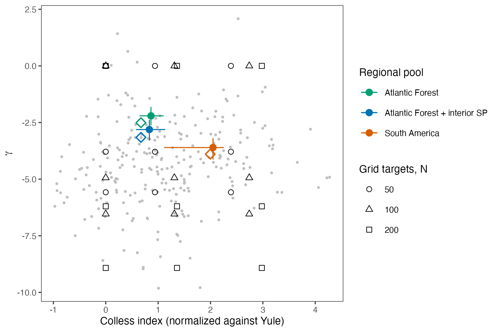

<!-- Render: quarto render manuscript/supporting_information.qmd, after
Rscript analysis/24_si_tables.R (tables in manuscript/si/). -->

```{r}
#| label: setup
si <- function(file) readr::read_csv(file.path("si", file), show_col_types = FALSE)
```

# Appendix S1. Extended methods

## Tree generator and calibration of the grid

We drew topologies from Aldous's β-splitting model (Aldous, 1996) and branching times from a pure-birth process in which each of the $k$ lineages diversifies at rate $k^{c}$, so that $c = 0$ corresponds to a Yule process and $c < 0$ to a slowdown in diversification, as under diversity dependence. We then ordered the nodes by a uniform linear extension of the partial order of the tree and set the root depth to one. Because γ depends only on the intervals between nodes and the Colless index only on the topology, this construction controls the two axes separately. This generator is our own design choice and not a published model; it replaced the library of trees from several generators, sampled by strata, that we had planned, because it gives independent control by construction.

We calibrated $c$ and β for each N with curves of the mean statistic against the parameter, and accepted a tree only when both statistics fell within 0.5 units of the targets of its cell, which gave acceptance rates of 9–25% (Table S1). Thus, every cell of the 3 × 3 grid could be filled. The Yule × Yule cell approximates the trees used in previous validations (Peres-Neto & Kembel, 2015; Duarte et al., 2016), since the acceptance window truncates the Yule distribution of both statistics.

## Phylogenetic signal in niche breadth and maximum abundance

When $\sigma_j$ or $h_j$ carried phylogenetic signal, we simulated a Brownian trait on the tree (λ = 1) and imposed on it the marginal distribution of the scenario without signal by ranks, that is, the species with the $m$-th largest Brownian value received the $m$-th largest value of a sample from the original distribution. Scenarios with and without signal therefore differed only in how the values were arranged on the tree.

## Layer B

The dynamics followed Thompson et al. (2020), which we implemented in R from the published equations, because neither the original Julia code nor the R package mcomsimr carries a licence. The expected abundance of species $j$ at site $i$ at time $t + 1$ was

$$\mu_{ij}(t) = \frac{r_j \exp\left[-\dfrac{(E_i - u_j)^2}{2\sigma_j^2}\right] N_{ij}(t)}{1 + \sum_k \alpha_{jk} N_{ik}(t)},$$

where $N_{ij}(t)$ is the abundance of species $j$ at site $i$ and $\alpha_{jk}$ is the effect of species $k$ on species $j$. We drew abundances from a Poisson distribution with mean $\mu_{ij}(t)$; each individual then emigrated with probability $a$, and each site received the emigrants of each species from all other sites in proportion to their number (a multinomial draw), so that the dispersal kernel was uniform. Our σ is the standard deviation of the Gaussian response, as in Layer A, and equals $\sqrt{2}$ times the breadth parameter of Thompson et al. (2020). The environment was static. All species were seeded with Poisson(0.5) individuals per site every 10 steps during the first 100 steps, the dynamics ran for 1,000 steps, and we kept only the final state, a single survey, rather than a temporal mean. Maximum growth rate $r_j$, drawn from a uniform distribution between 2 and 8, took the role of $h_j$ in the trait scenarios.

Under phylogenetic competition, interspecific coefficients came from a uniform distribution between 0 and 0.1, relative to an intraspecific coefficient of 1 (both multiplied by 0.05), and were assigned to species pairs by the rank of their phylogenetic similarity, so that close relatives competed more strongly. We calibrated the size of the pool for each archetype, scenario and N so that the mean number of species left after the dynamics was close to N, and drew the pool tree with the targets of its cell, recalibrating β and $c$ for each pool size. However, mass effects with phylogenetic competition could not reach N = 200, since pools of up to 2,900 species left only about 150 species, and we dropped this combination. We recorded γ and the Colless index of both the pool tree and the analysed tree.

## Permutation tests

We wrote the permutation loops ourselves for efficiency and checked, in unit tests, that the observed statistics equal those of the R packages vegan v. 2.7-6 (Oksanen et al., 2026) and PCPS v. 1.0.9 (Debastiani, 2026). The 999 permutations give P-values a resolution of 0.001.

## Node scores of the clade-recovery methods

For PCPS, PCC and evoPCA, each method took the axis most correlated with $E$ among its first four, and the score of each internal node was the absolute correlation between membership of its clade and the species scores on that axis. The species scores were the correlations of the columns of $\mathbf{P}$ with the PCPS axis, which equal the species scores of the R package PCPS; the values of the phylogenetic eigenvector for PCC; and the correlations of the species columns of the Hellinger-transformed table of evoPCA (Legendre & Gallagher, 2001). We did not use the branch loadings of evoPCA because, with incidence data, a branch is present wherever any of its descendants is, so the branch above a planted clade saturates and small subclades always correlate better with the axis. For phylofactorization (Washburne et al., 2017), the score of each split was the objective of the algorithm, the deviance explained by the phylogenetic factor in a binomial model with incidence data or the variance explained by the isometric log-ratio balance with abundance data; we computed it for every node, which gives the same best split as the R package phylofactor v. 0.0.1 (Washburne et al., 2017) while also ranking all nodes. For a given replicate, the planted clade, the optima and the gradient were the same across shifts and data types, so that only the factor of interest changed. The planted-clade objective replaced the per-node effect sizes under continuous Brownian motion that we had planned, because a planted clade defines unambiguously which answer is correct.

## Performance measures and formal models of the simulation results

With $K = 1{,}000$ replicates, the Monte Carlo standard error is at most 0.016 (at a rate of 0.5), and a 95% Monte Carlo interval around the nominal level spans about ±0.014; we chose $K$ so that this interval falls within Bradley's liberal criterion for acceptable type I error, [0.025, 0.075] (Bradley, 1978). The credible intervals of the formal models include the binomial variation among replicates.

The plan was to treat γ and the Colless index as continuous covariates, but each cell of the grid has a single target per axis, and Layer A did not store the shape of every tree, so a continuous term would only interpolate three points. Therefore, we entered the levels of both statistics as factors. In Layer A, the shape effects could differ among tests and scenarios, which is what testing a nuisance effect that depends on tree shape requires, and with N and data type; in the R formula notation, the model was test \* scenario \* (γ + Colless) + test \* (γ:Colless + N + data type) + test:(γ + Colless):(N + data type) + test:scenario:N, where the last term lets the scenario effects, such as the inflation under nuisance structure, differ with N. In Layer B, where only five cells were simulated, the cell entered as a five-level factor, in test \* archetype \* (scenario + cell) + test \* N \* (archetype + scenario + cell). The clade-recovery model was method \* (γ \* depth + Colless + γ:Colless + shift + N + data type) + method:(γ + Colless):(N + data type + shift).

We first fitted quasibinomial generalized linear models to the same structures, which showed a dispersion 2.1–8.5 times larger than binomial. The beta-binomial accounts for this extra variation with a single precision parameter φ, whereas a first version with an observation-level random effect hit the maximum tree depth of the sampler in almost every transition. We used normal(0, 1.5) for all coefficients on the logit scale; normal(−2.9, 1.5) for the intercept of the type I models, centred on logit(0.05), and normal(0, 1.5) for the other intercepts; and gamma(2, 0.01) for φ, which is weakly informative around the values implied by the quasibinomial dispersion (φ of about 130–910). We ran four chains of 2,000 iterations (1,000 of warm-up) with adapt_delta = 0.95 and a maximum tree depth of 12, since with the default of 10 a few transitions of the type I models reached the limit. Posterior predictive checks were in sample, both for each condition and for the sums over the conditions of each test, N and cell.

## Computation

The simulations of Layer A and Layer B ran in a Docker image on spot cloud instances with 192 virtual CPUs (190 workers); the pipeline seed was 20261018, from which the R package targets v. 1.12.0 (Landau, 2021) derives one seed per branch, with workers launched by crew v. 1.3.3 (Landau, 2026). Layer A took about 8 h for the 432,000 metacommunities of the main run and Layer B about 7.5 h for its 440,000. The clade-recovery runs took 1.2 h on a 16-core workstation, with one seed per tree, depth and replicate, and each formal model 1–7 min. The trait simulation, the β-splitting and branching-time generator and the calibration of the grid are our own R code in the repository.

# Appendix S2. Extended results

## Validation against published results

The static layer reproduced the published validations. In the Yule trees of Duarte et al. (2016), the rejection rates of the site shuffle, the taxa shuffle and the max test fell within the 95% binomial interval of our estimates in 66 of 72 cells. The six exceptions came from four conditions (PERMANOVA with both components at N = 100, with environment only at N = 200 and with phylogeny only at N = 200, and the Mantel test with environment only at N = 200), slightly more than the 3.6 cells expected by chance. The mean PERMANOVA R² and Mantel ρ agreed to the second decimal place when we used the Bray–Curtis dissimilarity without the square root, as in the code of Duarte et al. (2016); in the rest of the study we used the square-rooted version. The PCC matched the published rates of Peres-Neto and Kembel (2015) in the scenarios that do not depend on the tree. Its power was lower than published (0.93 against 0.95), and it varied between 0.71 and 0.93 among 20 Yule trees, so the published values lie just above that range, which seems to reflect a single favourable tree. Thus, our implementation closely reproduces both benchmarks.

## Type I error in Layer B

Under the null hypothesis, no lower CI bound exceeded 0.075 at N = 100 (largest posterior median 0.088). However, raw rejection rates exceeded that limit for GLM PCPS2 in S2σ under species sorting (0.094 at N = 100 and 0.104–0.129 at N = 200 in the low- and mid-γ cells) and for the PCC in S2h (0.085–0.089 at N = 100; 0.111 under species sorting and 0.116–0.143 under mass effects at N = 200).

## Clade recovery with abundance data

With abundance data, recovery was lower for the compositional phylofactorization (0.68 and 0.56 for basal and recent clades at N = 100) than for evoPCA (0.78 and 0.65), and PCPS gained 0.29 (95% CI 0.25–0.33) and 0.23 (0.21–0.25) with low γ.

## Convergence and fit of the formal models

All models converged, with $\hat{R}$ ≤ 1.01, bulk effective sample size ≥ 908 and tail effective sample size ≥ 1,477, no divergent transitions and no transition at the maximum tree depth (Table S3). The in-sample 95% posterior predictive intervals contained 96–98% of the observed rates of each condition and the 50% intervals 61–70%, so the predictive intervals are slightly wider than needed; when we summed the conditions of each test, N and cell, every group fell within its 95% interval.

# Appendix S3. Real pools and real metacommunities

## Methods

To show where real regional species pools fall in the grid of tree shapes, and how the methods behave with real data, we used 14 tadpole metacommunities compiled from the literature and from unpublished data. We harmonized species names with the Amphibian Species of the World (Frost, 2026; through the internal dataset of AmphiNom, updated on 16 October 2025) using the R package AmphiNom v. 1.1.0 (Liedtke, 2019), excluded undetermined taxa, and matched the remaining 123 species to the tips of the Portik et al. (2023) tree. We built three nested pools (Atlantic Forest; Atlantic Forest and interior of São Paulo; all South American metacommunities) pruned the tree to each, and computed γ and the normalized Colless index on the point-estimate tree and on its 100 time-calibrated bootstrap trees. For the case study, we used the metacommunities with at least 10 ponds and pond depth measured in every pond, namely two of the 14 and one additional published dataset: Serra da Bocaina (13 ponds; Provete et al., 2014), southern Brazil (32 ponds; Both et al., 2011) and northwestern São Paulo (40 ponds; Prado & Rossa-Feres, 2014). We applied all tests and the four clade-scoring methods to incidence data with pond depth as the gradient, and also with canopy cover in Bocaina, the variable associated with its phylogenetic composition in a previous analysis with PCPS (Provete, 2018).

## Results

The three regional pools of anurans fell inside the grid of tree shapes (Fig. S1). The Atlantic Forest pool (60 species) had γ = −2.51 and a normalized Colless index of 0.67; adding the metacommunities of the interior of São Paulo (81 species) lowered γ to −3.16 with the same Colless index (0.67), and the South American pool (123 species) had γ = −3.90 and a Colless index of 1.99. Thus, γ of the three pools lies between the Yule and the median levels of the grid, and imbalance between the Yule and the median levels except in the largest pool, which lies between the median and the 90% quantile. Across the 100 bootstrap trees of Portik et al. (2023), γ varied by about one unit and the Colless index by up to 1.1 units, and the point-estimate tree sat at the lower edge of the distribution of γ, probably because the bootstrap trees differ in topology and have deeper roots. As a consequence, the low-γ cells, where we found the largest effects of tree shape, are more extreme than these pools, but within the range of the anuran clades used to define the grid.

The three metacommunities of the case study had small trees with contrasting shapes. Bocaina (Provete et al., 2014; 15 species in 13 ponds) and southern Brazil (Both et al., 2011; 21 species in 32 ponds) had negative γ (−1.59 and −1.53), whereas northwestern São Paulo (Prado & Rossa-Feres, 2014; 26 species in 40 ponds) had positive γ (1.39), outside the range of the grid. No test rejected the null hypothesis of no association between phylogenetic structure and pond depth with the max test (all P ≥ 0.107). In Bocaina, canopy cover was marginally associated with phylogenetic composition under the site shuffle (P = 0.048 for PERMANOVA and 0.050–0.053 for GLM PCPS1, RDA PCPS and PCC), but not under the taxa shuffle (P = 0.23–0.56). This seems to indicate that canopy cover is related to the composition of these ponds, in line with the analysis with PCPS of Provete (2018), but that the phylogenetic arrangement of the species adds no detectable signal once the tips are permuted, which is the inference the max test protects. The clade-scoring methods partly agreed: in Bocaina, PCC, evoPCA and phylofactorization chose the same clade of five Dendropsophus and Scinax species along the depth gradient, and in northwestern São Paulo PCC and evoPCA chose the three microhylids; the agreement of the PCC is unexpected, given its poor recovery in the simulations. However, with 13–40 ponds and without a significant test, these clades describe the strongest phylogenetic contrast along the gradient rather than a demonstrated association.

{width=85%}

Fig. S1. Tree shape of three nested regional pools of anurans (filled points and bars, median and 2.5–97.5% quantiles across 100 bootstrap trees; open diamonds, point-estimate tree) against the targets of the simulation grid (open symbols, by N) and the anuran clades with 40–250 tips of Portik et al. (2023) (grey points). Notice that the pools fall inside the grid and close to its Yule and median levels, and that the point-estimate tree has a lower γ than most bootstrap trees.

# Table S1

Targets of the tree-shape grid for each pool size N. Levels of γ are zero (Yule), the median and the 10% quantile of the anuran clades with 40–250 tips of Portik et al. (2023); levels of the Colless index (normalized against its Yule expectation) are zero, the median and the 90% quantile. $c$ and β are the calibrated parameters of the generator, and acceptance is the proportion of simulated trees that fell within 0.5 units of both targets.

```{r}
#| label: tbl-s1
knitr::kable(si("table_S1_grid.csv"),
             col.names = c("N", "γ level", "Colless level", "γ target", "Colless target",
                           "c", "β", "Acceptance"))
```

# Table S2

Every rate of the study (rejection rate of each test, or hit rate of each clade-recovery method) by condition, with its Monte Carlo standard error, $\text{MCSE} = \sqrt{p(1 - p)/K}$ with $K = 1{,}000$ replicates, and the 95% Monte Carlo interval. The full table (file table_S2_rates_mcse.csv) has one row per condition; below we summarize the range of the MCSE by group of conditions.

```{r}
#| label: tbl-s2
s2 <- si("table_S2_rates_mcse.csv")
s2 |>
  dplyr::group_by(model) |>
  dplyr::summarise(conditions = dplyr::n(), rate_min = min(rate), rate_max = max(rate),
                   mcse_min = min(mcse), mcse_max = max(mcse), .groups = "drop") |>
  knitr::kable(digits = 3, col.names = c("Model", "Conditions", "Min. rate", "Max. rate",
                                          "Min. MCSE", "Max. MCSE"))
```

# Table S3

Convergence and posterior predictive diagnostics of the beta-binomial models: maximum rank-normalized $\hat{R}$, minimum bulk and tail effective sample sizes, numbers of divergent transitions and of transitions at the maximum tree depth, coverage of the 50% and 95% posterior predictive intervals for each condition and for the sums over the conditions of each test (or method), N and cell, and the dispersion of the quasibinomial model with the same structure.

```{r}
#| label: tbl-s3
knitr::kable(si("table_S3_diagnostics.csv"), digits = 3,
             col.names = c("Model", "Max. R-hat", "Min. bulk ESS", "Min. tail ESS", "Divergences",
                           "Max. tree depth", "50% cover", "95% cover", "50% cover (grouped)",
                           "95% cover (grouped)", "Dispersion"))
```

# References

Aldous, D. (1996). Probability distributions on cladograms. In D. Aldous & R. Pemantle (Eds.), *Random discrete structures* (pp. 1–18). The IMA Volumes in Mathematics and its Applications, Vol. 76. Springer. https://doi.org/10.1007/978-1-4612-0719-1_1

Both, C., Melo, A. S., Cechin, S. Z., & Hartz, S. M. (2011). Tadpole co-occurrence in ponds: when do guilds and time matter? *Acta Oecologica*, 37, 140–145. https://doi.org/10.1016/j.actao.2011.01.008

Bradley, J. V. (1978). Robustness? *British Journal of Mathematical and Statistical Psychology*, 31, 144–152. https://doi.org/10.1111/j.2044-8317.1978.tb00581.x

Debastiani, V. J. (2026). PCPS: principal coordinates of phylogenetic structure. R package version 1.0.9. doi:10.32614/CRAN.package.PCPS.

Duarte, L. D. S., Debastiani, V. J., Freitas, A. V. L., & Pillar, V. D. (2016). Dissecting phylogenetic fuzzy weighting: theory and application in metacommunity phylogenetics. *Methods in Ecology and Evolution*, 7, 937–946. https://doi.org/10.1111/2041-210X.12547

Frost, D. R. (2026). *Amphibian Species of the World: an online reference*. Version 6.2. American Museum of Natural History. https://amphibiansoftheworld.amnh.org/index.php https://doi.org/10.5531/db.vz.0001

Landau, W. M. (2021). The targets R package: a dynamic Make-like function-oriented pipeline toolkit for reproducibility and high-performance computing. *Journal of Open Source Software*, 6(57), 2959. https://doi.org/10.21105/joss.02959

Landau, W. M. (2026). crew: a distributed worker launcher framework. R package version 1.3.3. doi:10.32614/CRAN.package.crew.

Legendre, P., & Gallagher, E. D. (2001). Ecologically meaningful transformations for ordination of species data. *Oecologia*, 129, 271–280. https://doi.org/10.1007/s004420100716

Liedtke, H. C. (2019). AmphiNom: an amphibian systematics tool. *Systematics and Biodiversity*, 17, 1–6. https://doi.org/10.1080/14772000.2018.1518935

Oksanen, J., Simpson, G. L., Blanchet, F. G., Kindt, R., Legendre, P., Minchin, P. R., et al. (2026). vegan: community ecology package. R package version 2.7-6. doi:10.32614/CRAN.package.vegan.

Peres-Neto, P. R., & Kembel, S. W. (2015). Phylogenetic gradient analysis: environmental drivers of phylogenetic variation across ecological communities. *Plant Ecology*, 216, 709–724. https://doi.org/10.1007/s11258-014-0405-0

Portik, D. M., Streicher, J. W., & Wiens, J. J. (2023). Frog phylogeny: a time-calibrated, species-level tree based on hundreds of loci and 5,242 species. *Molecular Phylogenetics and Evolution*, 188, 107907. https://doi.org/10.1016/j.ympev.2023.107907

Prado, V. H. M., & Rossa-Feres, D. C. (2014). The influence of niche and neutral processes on a neotropical anuran metacommunity. *Austral Ecology*, 39, 540–547. https://doi.org/10.1111/aec.12114

Provete, D. B. (2018). Canopy cover and structural complexity affect the phylogenetic composition of a pond-dwelling Neotropical anuran metacommunity. *bioRxiv*, doi:10.1101/252478.

Provete, D. B., Gonçalves-Souza, T., Garey, M. V., Martins, I. A., & Rossa-Feres, D. C. (2014). Broad-scale spatial patterns of canopy cover and pond morphology affect the structure of a Neotropical amphibian metacommunity. *Hydrobiologia*, 734, 69–79. https://doi.org/10.1007/s10750-014-1870-0

Thompson, P. L., Guzman, L. M., De Meester, L., Horváth, Z., Ptacnik, R., Vanschoenwinkel, B., Viana, D. S., & Chase, J. M. (2020). A process-based metacommunity framework linking local and regional scale community ecology. *Ecology Letters*, 23, 1314–1329. https://doi.org/10.1111/ele.13568

Washburne, A. D., Silverman, J. D., Leff, J. W., Bennett, D. J., Darcy, J. L., Mukherjee, S., Fierer, N., & David, L. A. (2017). Phylogenetic factorization of compositional data yields lineage-level associations in microbiome datasets. *PeerJ*, 5, e2969. https://doi.org/10.7717/peerj.2969
